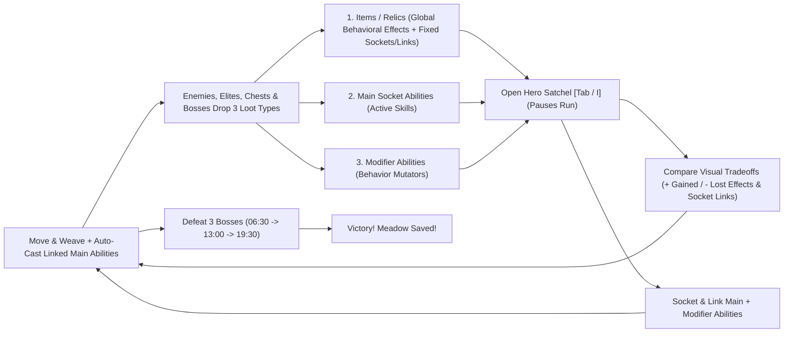

# Paw & Prism — Living Game Design Document (GDD)

> **Status:** Living Design Reference & Rework Blueprint  
> **Version:** `v2.2` (Satchel Equip Fix, Stripped Web Build, Drop-Rate Formula & Boss DPS Balance)  
> **Engine & Renderer:** Godot `4.7.2` (`GL Compatibility`)  
> **Live Web Build:** https://normandra.github.io/paw-and-prism/  
> **Repository:** https://github.com/normandra/paw-and-prism  
> **Target Platforms:** Web (single-threaded HTML5/WASM + PWA Service Worker, no `SharedArrayBuffer`), Android (`arm64-v8a` Portrait APK), macOS, Windows, Linux  

---

## How to Use This Document

Each section separates verified mechanics from future exploration:
1. **`Current Implementation` (Code-Verified `v2.2`):** Exact systems, tables, parameters, equations, and script owners active in the project.
2. **`Rework Ideas & Design Knobs`:** Checkable `[ ]` balance levers and next-step feature ideas ready to edit directly.

---

## 1. High Concept, Core Pillars & Gameplay Loop

**Pitch:** *Vampire Survivors meets Diablo behavioral item tradeoffs and Path of Exile ability linking in a cozy 3D woodland meadow.* Pick a chibi critter hero (or learn step-by-step in the bare-pawed Tutorial), weave effortlessly one-handed through 20 minutes of escalating critter swarms from Morning to Twilight, hunt strictly **3 ground loot types** (*Items*, *Main Socket Abilities*, and *Modifier Abilities*), weigh build-defining Relic tradeoffs inside a touch-scrollable Satchel, and defeat 3 telegraphed bosses.

### Core Design Pillars

| Pillar | Design Choice | Current Implementation (`v2.1`) | Primary Code Owners |
|---|---|---|---|
| **1. Zero Leveling / Pure Loot Power** | No XP bars, XP shards, or "pick 1 of 3" stat-stick modals | All hero power & playstyle mutations come exclusively from equipped Items and socketed/linked Abilities | `hero_stats.gd`, `loot_manager.gd` |
| **2. Behavioral Items & Rarity Tradeoffs** | Rarity shapes socket count & behavioral tradeoffs, never dull `+X%` fluff | `Common` / `Magic` / `Rare` / `Unique` items across 6 slots grant `18` behavioral/tradeoff Global Effects + `5` Unique Keystones + fixed socket/link rolls | `item_database.gd`, `item_instance.gd`, `inventory_panel.gd` |
| **3. PoE Ability Linking (Main + Modifier)** | Clean 2-type gem grammar | `10` Main Socket Abilities + `10` Modifier Abilities insert into fixed colored (`R`/`G`/`B`/`W`) sockets and share effects across linked gaps | `gem_database.gd`, `poe_socket_widget.gd`, `skill_executor.gd` |
| **4. PoE-Style Playable Tutorial** | Learn by looting & linking hands-on | Dedicated bare-pawed `TUTORIAL` run walking through **First Item -> First Main Ability -> First Linked Modifier** | `tutorial_director.gd`, `main_game.gd` |
| **5. Mobile Portrait & 3-Boss Gauntlet** | One-handed touch ergonomics & readable UI | Hop-Dash removed; `2.75×` portrait phone scaling, momentum `TouchScrollContainer`, 4-tab mobile Satchel, Android APK CI & 3 scripted bosses (`06:30`, `13:00`, `19:30`) | `wave_director.gd`, `touch_controls.gd`, `touch_scroll_container.gd`, `hud_controller.gd` |

### Core Moment-to-Moment Loop (`v2.1`)



### Rework Ideas — Core Loop
- [ ] **Post-Boss Endless Mode:** Add an optional **"Endless Twilight"** button on the Victory screen after defeating Boss 3 to test fully 4-linked builds past `20:00`.
- [ ] **Risk Shrines / Pacts:** Add clickable in-world Altars that corrupt or upgrade a worn Relic (e.g., add a extra Tradeoff effect or flip socket colors).
- [ ] **Smart Quick-Swap Tray:** Allow swapping to a recently looted Relic directly from a compact bottom-right toast button without pausing for common upgrades.

---

## 2. Controls, Camera & Core Combat Rules

### Controls (`Current Implementation`)

| Input | Action | Notes |
|---|---|---|
| `WASD` / `Arrow Keys` | 8-directional movement | Clamped to `±66.5m` inside `136×136m` arena (`ArenaBuilder.ARENA_HALF_SIZE = 68.0`) |
| **Touch Drag** *(Mobile)* | Analog floating virtual joystick (`touch_controls.gd`) | Pure drag-anywhere floating stick (`BASE_RADIUS = 56px`, `KNOB_RADIUS = 22px`), bottom-center `"DRAG TO MOVE"` hint in portrait; auto-enabled on touchscreens/Android or `?mobile=1` |
| **Touch Swipe** *(Satchel / EndScreen)* | Momentum vertical scroll (`touch_scroll_container.gd`) | Global drag-to-scroll (`>10px` threshold + inertia glide); blocks accidental taps via `was_recent_drag(180)` |
| `Tab` / `I` | Toggle Hero Satchel | Pauses combat; 4-tab Portrait (`Gear \| Items \| Skills \| Build`) on phones, 3-column layout on Desktop |
| `Esc` | Pause / Resume (`EndScreen`) | Also closes Satchel if open |
| `M` | Toggle procedural audio mute | Reflected in HUD `[M]` button |
| `F3` | Toggle FPS readout pill | Visible automatically when `?review=1` or `--review` is active |
| `F8` / `F9` (`?review=1` only) | Debug helpers | `F8`: seed Unique/Rare/Magic items + sample Main/Mod gems · `F9`: trigger Victory screen |

### Camera Rig (`main_game.gd`)
- **Perspective FOV:** `48.0°`, `far = 160.0`
- **Title Showcase Camera:** Landscape `Vector3(0.0, 2.38, 5.85)` aiming at `(0, 0.56, 0)`; Portrait (`vp.y > vp.x * 1.05`) `Vector3(0.0, 2.65, 7.20)` aiming at `(0, 0.25, 0)`.
- **Gameplay Chase Camera:** Landscape offset `Vector3(0.0, 17.5, 13.5)`; Portrait `Vector3(0.0, 22.5, 17.0)`; smooth lerp `min(1.0, delta * 9.0)` + quadratic trauma screen shake (`_shake_trauma² * 0.55`).

### Combat & Scaling Mechanics (`player_controller.gd`, `hero_stats.gd`, `skill_executor.gd`)
- **Hero Baseline Stats (fixed per hero, zero stat-stick bloat):**
  - `hp_regen = 0.8/s`, `crit_chance = 8.0%`, `crit_mult = 165.0%`.
  - Post-hit invulnerability: `0.45s` (`1.6s` when *Nine-Lives Bell* `cheat_death` saves from lethal hit with `55%` Max HP heal, `90s` CD).
  - Incoming damage formula: `max(1.0, raw_dmg * incoming_dmg_mult)` (`1.45×` when `glass_spark` is equipped, `1.0×` otherwise).
- **Dynamic Cooldown Flow (`skill_executor.gd`):**
  - Base compiled cooldown floor: `max(0.18s, final_cd)`.
  - Dynamic tick multiplier `cd_rate`: `1.0×` baseline; modified by **`turret_stance`** (`2.0×` faster while standing still, `0.75×` slower while moving) and **`zoomies_on_kill`** (`1.25×` cast rate + `1.28×` move speed for `2.0s` after any kill).
- **Elemental & Leech Riders:**
  - Fire skills & `mod_ignite`: apply `25–28%` DPS Burn for `3.0s`.
  - Cold skills & `mod_chill`: apply Chill slow for `2.5s` (also primes targets for `frost_shatter` icy death rings).
  - `mod_leech`: heals `5.5%` of linked skill damage dealt per hit, capped at `8%` `max_hp` per hit.

### Rework Ideas — Combat & Camera
- [ ] **Optional Cursor / Right-Stick Aiming:** Toggle between Auto-Aim Nearest and Cursor Aim (`[Q]`) for deliberate *Boomerang Bone* or *Sniper Focus* piercing shots.
- [ ] **Manual Relic Active Trigger (Optional):** Evaluate whether a single optional portrait thumb-skill (or stride trigger indicator) improves active boss dodging without cluttering one-handed play.
- [ ] **Micro Impact Juice:** Subtle hit-stop freeze frames or squash/stretch pop on `cheat_death`, boss phase changes, and corpse explosions.

---

## 3. Playable Heroes (`scripts/data/hero_database.gd`)

In a standard **20-Min Run**, each hero starts equipped with a **Magic 2-link Starter Weapon** (containing their Main Ability, 1 open linked Modifier socket, and 1 signature Global Effect) plus a **Common Meadow Cap** (`[G, B]` unlinked sockets, `0` effects). In **Tutorial Mode**, all heroes start completely bare (`init_bare_for_tutorial()`).

| ID | Hero & Title | HP | Speed | Starter Weapon (`Magic`, 2-Link) | Starter Main Ability | Signature Effect | Starter Hat | Tagline |
|---|---|---|---|---|---|---|---|---|
| `shiba` | **Mochi the Shiba**<br>*Acorn Ranger* | `135` | `8.6` | *Mochi's Acorn Wand* (`G=G`) | *Acorn Barrage* (`ACRN`) | `zoomies_on_kill` (*Kills -> Speed Burst*) | `ribbon_hood` | Fast pup bursting with speed after every kill |
| `bunny` | **Pip the Bunny**<br>*Starlight Mage* | `120` | `9.0` | *Pip's Star Staff* (`B=G`) | *Starlight Orbs* (`STAR`) | `orbit_shield` (*Hit -> Star Shield*) | `wizard_hat` | Swift bunny summoning swirling star blades |
| `bear` | **Bramble the Bear**<br>*Honey Paladin* | `155` | `8.0` | *Bramble's Honey Hammer* (`R=B`) | *Honey Slam* (`SLAM`) | `stride_honey_nova` (*Moving -> Honey Nova*) | `leaf_crown` | Sturdy bear pulsing honey novas while marching |
| `cat` | **Nori the Cat**<br>*Storm Whisker* | `125` | `8.9` | *Nori's Spark Claws* (`B=G`) | *Whisker Lightning* (`ZAP`) | `static_sprint` (*Moving -> Zap Sparks*) | `knight_helm` | Zippy cat sparking lightning arcs on the run |

### Rework Ideas — Heroes
- [ ] **Permanent Innate Traits:** Keep a hero's signature trait innate in addition to weapon swaps so *Bramble* always retains melee brawling flavor or *Pip* always hovers lightly over slows.
- [ ] **5th Playable Hero:** Add *Maple the Red Panda* starting with *Spirit Bees* (`G=G`) + `short_barrage` or `ember_corpse`.

---

## 4. Behavioral Items, Global Effects & Tradeoffs (`item_database.gd`, `item_instance.gd`)

Items NEVER roll plain numerical stats like `+12% Damage` or `item_level`. Instead, every dropped Relic carries **fixed sockets/links** plus **1–2 Global Behavioral Effects** (often pairing an upside with a meaningful constraint or tradeoff!).

### Gear Slots & Fixed Socket/Link Budget (`GameEnums.slot_max_sockets`)

| Slot | Base Names | Max Sockets | Common Roll | Magic Roll | Rare Roll |
|---|---|---|---|---|---|
| **Weapon** | Acorn Wand, Honey Hammer, Starlight Staff, Paw Claws | `4` | `1` eff, `1–2S` (`38%` link, `4%` W) | `2` eff, `2–3S` (`58%` link, `6%` W) | `2` eff, `3–4S` (`76%` link, `10%` W) |
| **Helmet** | Sprout Hood, Wizard Hat, Knight Cap, Ribbon Hood | `3` | `1` eff, `1–2S` | `2` eff, `2–3S` | `2` eff, `3S` |
| **Armor** | Cozy Tunic, Bark Vest, Velvet Cloak | `4` | `1` eff, `1–2S` | `2` eff, `2–3S` | `2` eff, `3–4S` |
| **Boots** | Paw Slippers, Meadow Boots, Cloud Treads | `3` | `1` eff, `1–2S` | `2` eff, `2–3S` | `2` eff, `3S` |
| **Amulet** | Acorn Charm, Bell Pendant, Prism Locket | `2` | `1` eff, `1–2S` | `2` eff, `2S` | `2` eff, `2S` |
| **Ring** | Clover Ring, Amber Band, Dewdrop Signet | `2` | `1` eff, `1–2S` | `2` eff, `2S` | `2` eff, `2S` |

- **Drop Rarity Odds:** Standard: `5%` Unique / `22%` Rare / `43%` Magic / `30%` Common. With **`lucky_clover`**: `14%` Unique / `40%` Rare / `36%` Magic / `10%` Common (+`14%` link rate & +`5%` White socket rate).
- **Smart Magic Bias:** Magic items explicitly pair a non-tradeoff effect with a tradeoff effect (or vice-versa) so even blue drops ask an immediate build question!
- **No Crafting Clutter:** Prism Dust and manual socket/link rerolling are removed — socket layouts are fixed identity traits on each Relic, making a well-linked Rare a genuine find.

### Complete Global Behavioral Effects Catalog (`18` Standard/Tradeoff + `5` Unique Keystones)

#### Standard & Tradeoff Global Effects (`18`)

| Effect ID | In-Game Tag | Tradeoff? | Exact Gameplay Behavior |
|---|---|---|---|
| `stride_honey_nova` | **Moving -> Honey Nova** | No | Every `7.0m` traveled unleashes a `4.4m` slowing Honey Nova (`24` dmg) |
| `cadence_burst` | **4th Cast -> Burst \| Slow** | **Yes** | Every `4th` non-orbit cast erupts a `4.6m` burst (`34` dmg + Chill), at `1.18×` skill cooldowns |
| `turret_stance` | **Stand Still -> 2x Cast** | **Yes** | Standing still ticks skill cooldowns `2.0×` faster; moving ticks at `0.75×` |
| `zoomies_on_kill` | **Kills -> Speed Burst** | No | Every critter kill grants `2.0s` of Zoomies (`1.28×` move speed, `1.25×` cast rate) |
| `edge_ricochet` | **Shots Bounce Back** | No | Non-boomerang projectiles bounce back toward nearest enemy once (`0.85×` lifetime) on timeout or arena wall |
| `short_barrage` | **+2 Shots \| Short Range** | **Yes** | `+2` projectiles/orbiters globally, but projectile lifetime shrinks to `0.55×` |
| `sniper_focus` | **Pierce +2 \| 1 Fast Shot** | **Yes** | Forces `1` projectile per cast, sets `pierce +2`, `1.55×` projectile speed, `1.45×` damage |
| `giant_slow_aoe` | **Huge AoE \| Slower Cast** | **Yes** | `AoE` & `Orbit` skills gain `1.65×` radius, at `1.33×` longer cooldown |
| `ember_corpse` | **Kills -> Fire Pop** | No | Defeated critters detonate in a `3.6m` fiery nova (`24` dmg + Burn) |
| `frost_shatter` | **Chill Kills -> Ice Ring** | No | Defeating a chilled critter triggers a `4.4m` icy ring (`26` dmg + Chill slow) |
| `static_sprint` | **Moving -> Zap Sparks** | No | Every `5.5m` traveled zaps up to `2` nearby foes (`20` dmg lightning arcs) |
| `kill_siphon` | **Kills -> Siphon Heal** | No | Every critter kill restores `+2.5 HP` |
| `thorns_burst` | **Hit -> Bramble Nova** | No | Taking damage triggers a `4.4m` Bramble Nova (`26` dmg, `1.2s` CD) |
| `gravity_slams` | **AoE Pulls Foes In** | No | Player novas, meteors & explosions yank hit critters inward instead of knocking away |
| `glass_spark` | **Heavy Impact \| Fragile** | **Yes** | All compiled abilities deal `1.75×` damage, but hero takes `1.45×` incoming damage |
| `fleet_paws` | **Moving -> Speed Ramp** | No | Continuous movement ramps up to `+25%` move speed over `2.0s` |
| `orbit_shield` | **Hit -> Star Shield** | No | Taking damage activates `3` orbiting star shields (`2.6m`, `22` dmg) for `5.0s` (`6.0s` CD) |
| `lucky_clover` | **Rarer Loot & Links** | No | Upgrades ground drop & chest rarity weights (`14%` Unique / `40%` Rare) and boosts socket link odds (`+14%`) |

#### Unique Items & Exclusive Keystones (`6 Uniques`, `5 Unique Effects`)

| Unique Item | Slot | Fixed Sockets | Global Effects | Signature Build Identity |
|---|---|---|---|---|
| **Grand Acorn Scepter** | Weapon | `G=G=B=R` (`4L`) | `nova_barrage` (*All Shots Fire 360 Ring*) + `short_barrage` | Turns projectile casts into short-range 360-degree bullet rings |
| **Prismwhisker Crown** | Helmet | `W=W=W` (`3L`) | `prism_echo` (*Linked Mods Double-Proc*) + `lucky_clover` | Doubles linked Modifier counts (`+2 -> +4` etc.), triggers Double Echo on linked skills & boosts rarity |
| **Honeycomb Aegis** | Armor | `R=R=B=G` (`4L`) | `aegis_freeze` (*Hit -> Freezing Honey Nova*) + `thorns_burst` | Retaliatory tank chest erupting `5.2m` freezing novas (`32` dmg) + bramble bursts when hit |
| **Paws of the Comet** | Boots | `G=G=B` (`3L`) | `comet_stride` (*Moving -> Bonus Casts*) + `fleet_paws` | Ramps up to `+25%` move speed while moving and triggers bonus casts of all non-orbit Main Abilities every `8.5m` traveled |
| **Nine-Lives Bell** | Amulet | `W=B` (`2L`) | `cheat_death` (*Fatal Hit -> Burst Heal*) + `zoomies_on_kill` | Prevents fatal blow (`55%` heal + `1.6s` i-frames, `90s` CD) while chaining kill Zoomies |
| **Starweaver Band** | Ring | `B=G` (`2L`) | `gravity_slams` (*AoE Pulls Foes In*) + `ember_corpse` | Clusters foes into AoEs and chain-detonates kills with Fire Pops |

### Rework Ideas — Behavioral Items
- [ ] **Cross-Slot Combo Sets / Synergy Icons:** Highlight active synergies inside the Tradeoff Inspector (e.g., show an amber combo indicator when `comet_stride` + `stride_honey_nova` or `gravity_slams` + `ember_corpse` are both active).
- [ ] **Additional Uniques (`Target 12+`):** Add Unique armor/amulet built specifically around `edge_ricochet` + `sniper_focus` (super-pinball single-shot sniper) or minion/orbit loops.

---

## 5. Ability Linking System (`gem_database.gd`, `hero_stats.gd`)

Only **Main Socket Abilities (`MAIN`)** and **Modifier Abilities (`MODIFIER`)** exist. Gems do not gain XP or have numeric levels — what matters is **how many Main Abilities you load (`Focus Tax`), which Modifiers share a contiguous link group with them, and how item Global Effects reshape them**.

- **Multi-Main Focus Load (`hero_stats.gd`):** Equipping $N \ge 1$ Main Socket Abilities multiplies every Main skill's cooldown by $\text{CD}_{\text{focus}}(N) = 1.0 + 0.25 \cdot (N - 1)$ (`1.00×` for `1` Main, `1.25×` for `2`, `1.50×` for `3`, `1.75×` for `4`). Spreading across extra unlinked skills trades single-target speed for coverage rather than multiplying free DPS.
- **Same-Volley Shotgun Dampener (`projectile_entity.gd`, `enemy_entity.gd`, `skill_executor.gd`):** When multiple projectiles from the **same cast volley** (`cast_uid`) strike the same enemy, the 1st hit deals **`1.00×`** damage and each extra projectile from that same volley deals **`0.35×`**. (`edge_ricochet` bounce-backs refresh as `-cast_uid` for a clean `1.00×` return hit.)
- **`Prismwhisker Crown` Balance (`hero_stats.gd`):** `prism_echo` grants Double Echo (`0.80×` per cast when `mod_echo` is not already linked) while doubling linked Modifier counts.

### Main Socket Abilities (`10`)

| ID | Name (`Short`) | Color | Tags | Damage | Cooldown | Base Behavior |
|---|---|---|---|---|---|---|
| `acorn_barrage` | **Acorn Barrage** (`ACRN`) | Green | `Proj`, `Phys` | `24` | `0.65s` | Aimed fan of flying acorns (`1` base proj, spd `22`) |
| `starlight_orb` | **Starlight Orbs** (`STAR`) | Blue | `Spell`, `Orbit`, `AoE` | `21` | `0.45s` | Persistent `2` orbiting star blades (`3.4m` radius, `99` pierce) |
| `honey_slam` | **Honey Slam** (`SLAM`) | Red | `Melee`, `AoE`, `Phys` | `42` | `1.25s` | Slowing honey shockwave near nearest target (`4.3m` radius) |
| `whisker_lightning` | **Whisker Lightning** (`ZAP`) | Blue | `Spell`, `Chain`, `Lightning` | `28` | `0.88s` | Instant static arc jumping across `2` base chains |
| `petal_cyclone` | **Petal Cyclone** (`PETL`) | Green | `AoE`, `Proj`, `Phys` | `17` | `1.08s` | Rotating `6`-petal outward spiral (`1` pierce) |
| `fireball_berry` | **Fireball Berry** (`FIRE`) | Red | `Proj`, `Spell`, `AoE`, `Fire` | `34` | `1.18s` | Explosive burning berry (`3.2m` splash + Burn DoT) |
| `frost_nova` | **Frost Nova** (`FRST`) | Blue | `Spell`, `Proj`, `AoE`, `Cold` | `22` | `1.45s` | `4.2m` Chill ring (`0.7×` dmg) + `8` radial ice shards |
| `boomerang_bone` | **Boomerang Bone** (`BONE`) | Red | `Proj`, `Phys` | `28` | `1.08s` | Heavy `99`-pierce bone flying outward and returning to hero |
| `meteor_pine` | **Meteor Pinecone** (`PINE`) | Red | `Spell`, `AoE`, `Fire` | `66` | `2.05s` | Drops heavy burning pinecone slam (`4.2m`) on densest critter cluster |
| `spirit_bees` | **Spirit Bees** (`BEES`) | Green | `Minion`, `Proj`, `Phys` | `20` | `0.98s` | Fires `2` naturally homing bees |

### Modifier Abilities (`10`)

| ID | Name (`Short`) | Color | Required Tags | Linked Mutation |
|---|---|---|---|---|
| `mod_multishot` | **Multi-Shot** (`MULT`) | Green | `Proj` or `Orbit` | `+2` projectiles/orbiters (`0.80×` dmg per hit) |
| `mod_chain` | **Chain Bounce** (`CHN`) | Green | `Proj` or `Chain` | Bounces `+2` additional targets |
| `mod_fork` | **Twin Fork** (`FORK`) | Green | `Proj` | Projectiles split into `2` angled projectiles on first hit |
| `mod_pierce` | **Deep Pierce** (`PRCE`) | Green | `Proj` | Pierces `+3` targets |
| `mod_homing` | **Homing Seekers** (`HOME`) | Green | `Proj` | Smooth steering toward nearest enemies + `1.15×` projectile speed |
| `mod_echo` | **Double Echo** (`ECHO`) | Blue | *Any Main* | Triggers a delayed echo cast (`0.16s` later) / `+1` orbiter (`0.78×` dmg/hit) |
| `mod_nova_area` | **Giant Blast** (`WIDE`) | Blue | `AoE` or `Orbit` | Expands AoE/Orbit radius (`1.55×`) |
| `mod_ignite` | **Blazing Burn** (`BURN`) | Red | *Any Main* | Hits ignite critters (`25–28%` DPS Burn for `3.0s`) |
| `mod_chill` | **Frost Chill** (`CHIL`) | Blue | *Any Main* | Hits apply `2.5s` Chill slow (combos with *Frost Shatter*) |
| `mod_leech` | **Life Siphon** (`HEAL`) | Red | *Any Main* | Heals hero for `5.5%` of linked skill damage dealt |

---

## 6. Playable PoE-Style Tutorial (`scripts/systems/tutorial_director.gd`)

Launchable directly via **`TUTORIAL`** on the Title Screen. The player starts completely **bare-pawed** (`0` equipped items, `0` abilities) and learns the entire core loop through 3 short interactive beats:

| Beat | Step Sequence | Ground Spawn / Trigger | Top HUD Plaque | Satchel Banner Guidance |
|---|---|---|---|---|
| **1/3 — First Item** | `LOOT_ITEM` -> `EQUIP_ITEM` | Drops **`Meadow Acorn Wand`** (`Magic`, `G=G` 2-link, `stride_honey_nova`) `4.2m` north | `1/3  Walk to Wand` -> `1/3  Equip Wand [Tab]` (pulses Satchel button gold) | `Items tab -> Select Meadow Acorn Wand -> Equip` |
| **2/3 — Main Ability** | `LOOT_MAIN` -> `SOCKET_MAIN` -> `KILL_WAVE_1` | Equipping wand drops **`Acorn Barrage`**; socketing spawns `3` `slime_frog` critters (`0.55×` HP) | `2/3  Pick up Acorn Barrage` -> `2/3  Socket Ability [Tab]` -> `2/3  Defeat Critters (0/3)` | `Main tab -> Select Acorn Barrage -> Click Green Socket` |
| **3/3 — Linked Modifier** | `LOOT_MOD` -> `SOCKET_MOD` -> `KILL_WAVE_2` | 3 kills drops **`Multi-Shot`**; linking spawns `5` `slime_frog` critters (`0.60×` HP) -> `EndScreen.show_tutorial_complete()` | `3/3  Pick up Multi-Shot` -> `3/3  Link Modifier [Tab]` -> `3/3  Test Multi-Shot (0/5)` | `Mods tab -> Select Multi-Shot -> Click Linked Socket` |

---

## 7. 20-Minute Run Pacing, Drop-Rate Formula & DPS Balance Model

### Loot Drop-Rate Formula & 20-Minute Drop Budget (`loot_manager.gd`, `wave_director.gd`)
Only **3 collectible types** + **Acorn Treasure Chests** spawn on the meadow floor (`2.6m` pickup radius for Items/Main/Mod, `2.8m` for Chests; no XP shards, hearts, or dust pickups). Because swarm density climbs `~5.94×` from `00:00` (`2 / 0.95s`) to `17:30+` (`5 / 0.40s`), regular enemy drop odds are **time-normalized** against spawn intensity and gated by cooldowns + dry-streak pity so drops stay exciting rather than flooding the bag:

1. **Wave Spawn Intensity $S(t)$:**
   $$S(t) = \max\!\left(1.0,\; \frac{\text{batch}(t)\,/\,\text{interval}(t)}{2\,/\,0.95}\right)$$
   - `00:00`: $S = 1.00$ · `04:20`: $S = 2.19$ · `10:40`: $S = 3.80$ · `17:30`: $S = 5.94$
2. **Regular Enemy Drop Probabilities (checked only after minimum cooldown elapsed):**
   - **Item Chance** (gate $\Delta t \ge 16.0\text{s}$, or `12.5s` with `lucky_clover`):
     $$P_{\text{item}}(t, L, k_i) = \text{clamp}\!\left(\frac{0.018 \cdot (1.30 \text{ if } L \text{ else } 1.0)}{S(t)^{0.75}} + \max(0,\, k_i - 65) \cdot 0.0015,\;\; 0.002,\;\; 0.12\right)$$
   - **Ability Gem Chance** (gate $\Delta t \ge 24.0\text{s}$, or `19.0s` with `lucky_clover`):
     $$P_{\text{gem}}(t, L, k_g) = \text{clamp}\!\left(\frac{0.011 \cdot (1.30 \text{ if } L \text{ else } 1.0)}{S(t)^{0.75}} + \max(0,\, k_g - 95) \cdot 0.0012,\;\; 0.0015,\;\; 0.09\right)$$
   - Dry counters $k_i, k_g$ increment per regular kill and reset to `0` on drop (`k_i` Grace `65`, `k_g` Grace `95`). Opening rates start at `1.8%` Item / `1.1%` Gem (`2.34%` / `1.43%` Lucky) and taper to `0.47%` / `0.29%` at `17:30`.
3. **Structured Drop Sources & Expected 20-Minute Run Budget:**
   - **Regular Critters (cooldown-gated):** `~18–26` Items (`~1.0–1.5/min`) and `~12–18` Ability gems.
   - **Elite Critter** *(initial `65s`, repeat every `80s`, `~14` per run)*: `65%` (`80%` Lucky) Item (`42%`/`60%` Rare else Magic) · `40%` (`55%` Lucky) Ability gem · `+18 HP` heal.
   - **Acorn Treasure Chest** *(initial `55s`, repeat every `95s`, `~12` per run, `16–26m` away)*: `100%` Item (`52%`/`72%` Lucky Rare else Magic) · `50%` (`68%` Lucky) Ability gem · `+35 HP` heal.
   - **Boss (`3` per Run):** `1` Unique Item + `1` Rare Item + `1` Main Ability + `1` Modifier Ability + `+50 HP` heal.

### Theoretical Single-Ability Maxed-Support DPS Ceiling & Enemy HP Baseline
Baseline critical factor across all heroes is $\mathbb{E}[\text{crit}] = 1 + 0.08 \times (1.65 - 1) = 1.052$. Because additional equipped Main Abilities increase all cooldowns by `+25%` per extra skill ($\text{CD}(N) = 1 + 0.25(N - 1)$), peak single-target boss DPS comes from funneling a **single Main Ability (`N = 1`)** into a 4-link with top behavioral Uniques/Tradeoffs:

| Maxed Single-Ability Archetype (`N = 1`, 4-Link BiS) | Stack Formula (Single Target) | Stationary Peak DPS | Kiting / Mixed DPS | Role & Tradeoff |
|---|---|---|---|---|
| **Acorn Barrage Sniper** (`sniper_focus` + `glass_spark` + `prism_echo` `0.80×` + `turret_stance` + `mod_ignite`) | $24 \times 1.45 \times 1.75 \times 0.80 \times 1.052 = 51.3/\text{hit}$; `2` casts/`0.65s` | **`328 DPS`** *(w/ burn)* | **`~190–290 DPS`** | Best pure boss-killer (`+45%` incoming dmg taken) |
| **Spirit Bees Homing** (`mod_multishot` `0.80×` -> `6` bees, `0.35×` shotgun weight `= 2.75×/volley` + `glass_spark` + `prism_echo` + `turret_stance`) | $20 \times 0.80 \times 1.75 \times 0.80 \times 1.052 \times 2.75 = 64.8/\text{volley}$; `2` volleys/`0.98s` | **`265–337 DPS`** *(w/ adds Zoomies)* | **`~165–240 DPS`** | Reliable auto-tracking while dodging |
| **Meteor Pinecone AoE** (`mod_nova_area` + `glass_spark` + `prism_echo` `0.80×` + `turret_stance` + `comet_stride`) | $66 \times 1.75 \times 0.80 \times 1.052 = 97.2/\text{hit}$; `2` hits/`2.05s` (`+24.3` Burn) | **`214 DPS`** *(+`~90` stride casts)* | **`~210–300 DPS`** | Massive AoE pack + add clear |

- **Target Boss & Elite Baseline Against Practical Ceiling (`~240–330 DPS` Maxed / `~110–180 DPS` Mid-Run):**
  - **`06:30` Sir Grizzle:** **`3,000 HP`** -> `~20–28s` duel at `110–150 DPS`.
  - **`13:00` Lady Whiskers:** **`7,000 HP`** -> `~30–40s` duel at `175–230 DPS`.
  - **`19:30` King Bramblehorn:** **`15,000 HP`** -> `~45–60s` finale duel at `250–330 DPS` (no longer dies in `5–10s` to un-dampened projectile shotgunning).
  - **Elite `Bandit Raccoon` at Twilight (`17:30+`, `96 × 6.0 × 3.6 = 2,074 HP`):** `~7–10s` late-game mini-boss threat.

### Wave Pacing (`enemy_database.gd`, `wave_director.gd`)
Rebalanced `hp_scale` (`1.00× -> 6.00×`) and boss HP (`3000`, `7000`, `15000`) to stay tense against maxed 4-link + Unique builds:

| Time Window | Biome Phase | Enemy Pool | Spawn Int | Batch | HP Scale | Dmg Scale | Max Active (Desk / Web) |
|---|---|---|---|---|---|---|---|
| `00:00–02:00` | Sunny Meadow | Frog, Hedgehog | `0.95s` | `2` | `1.00×` | `1.00×` | `42` / `30` |
| `02:00–04:20` | Sunny Meadow | Frog, Hedgehog, Owl-Bat | `0.78s` | `3` | `1.30×` | `1.10×` | `62` / `44` |
| `04:20–07:00` | Sunny Meadow | Hedgehog, Owl-Bat, Boar, Frog | `0.65s` | `3` | `1.75×` | `1.22×` | `80` / `57` |
| `07:00–10:40` | Golden Sunset | Owl-Bat, Boar, Gloom Fox, Hedgehog | `0.56s` | `4` | `2.45×` | `1.42×` | `96` / `69` |
| `10:40–14:00` | Golden Sunset | Boar, Gloom Fox, Bandit, Shroom-Toad | `0.50s` | `4` | `3.40×` | `1.65×` | `112` / `80` |
| `14:00–17:30` | Twilight Grove | Fox, Bandit, Toad, Boar, Owl-Bat | `0.44s` | `5` | `4.60×` | `1.90×` | `124` / `89` |
| `17:30–20:00` | Twilight Finale | Bandit, Toad, Gloom Fox, Boar | `0.40s` | `5` | `6.00×` | `2.20×` | `135` / `97` |

- **Swarm Surges:** `04:00`, `09:30`, `15:30`, and `18:00` (`12` Web / `14` Desktop critters).
- **Scripted Bosses (`enemy_entity.gd`):**
  - `06:30` (**Sir Grizzle**, `3,000 HP`, `24 dmg`) — Honey Slam (`5.4m`) & Dash Charge (`3.4×` spd); spawns `4x` `acorn_boar` <= `50%` HP.
  - `13:00` (**Lady Whiskers**, `7,000 HP`, `30 dmg`) — `7`-way (`9` enraged) projectile fans, `5x` meteor rings, `12`-orb radial volley.
  - `19:30` (**King Bramblehorn**, `15,000 HP`, `38 dmg`) — `12`-way (`16` enraged) spiral volley, `4x` meteors, cross nova, spawns `3x` `gloom_fox` <= `50%` HP.

---

## 8. Art Direction, Icon-First UI & Mobile Support

### Low-Text Storybook Design System & Mobile Portrait UX (`ui_helper.gd`, `ui_icons.gd`, `poe_socket_widget.gd`, `touch_scroll_container.gd`)
- **Theme:** 3-tier warm timber (`BG_WOOD_DEEP #1C1412`, `BG_WALNUT #30241C`, `BG_OAK_CARD #3D2E24`, `BG_WELL #17120F`), Enchanted Gold (`#F5C957`), Antiqued Brass (`#947342`), Fredoka 700 headers & Nunito 600/800 body/labels.
- **Responsive Mobile Scaling (`main_game.gd`):** Dynamically sets `root.content_scale_factor` to **`2.75`** on tall portrait phones (`aspect_hw > 1.50`), **`1.95`** on square/tablet portrait (`1.05..1.50`), **`1.45`** on mobile landscape, and **`1.0`** on desktop — keeping all phone UI crisp at `~465×1007` logical px without squinting.
- **Title Screen (`title_screen.gd`):** Concise subtitle pill, 4 visual hero cards (`Portrait + Hero Name + Role + Starter Main Ability + Starter Effect chip`), hero tagline + control hint, and dual **`TUTORIAL`** + **`PLAY RUN`** CTAs (auto-collapses to `2×2` grid in portrait).
- **Gameplay HUD (`hud_controller.gd`):** Top XP bar, Dash bar, and `Lv.` / `Dust` / passive rows removed. Displays Hero Portrait + Kills + Bosses counter, Center Clock/Biome plaque (or Tutorial Objective plaque), full-width bottom `HP` + `Satchel` dock on portrait (`vp.x < 750`), and compact bottom-center Active Ability bar (`74×72` portrait cards).
- **Hero Satchel & Touch Scroll (`inventory_panel.gd`, `touch_scroll_container.gd`, `poe_socket_widget.gd`, `end_screen.gd`):**
  - All Satchel & EndScreen scrollable lists use `TouchScrollContainer` (global touch/mouse vertical drag scroll `DRAG_THRESHOLD = 14px` + momentum glide) while item cards & `PoESocketWidget` use `MOUSE_FILTER_STOP` with release-without-drag tap guards (`was_recent_drag(180)`, `<18px` drift) so tapping or swiping never swallows taps.
  - **One-Tap Item Equipping:** Opening the Items view auto-selects bag Relic #0 (showing its Tradeoff Card + `Equip` CTA immediately), and every item row also includes a direct emerald `Equip` button plus a top confirmation strip (`Equipped <Item>!`).
  - **Mobile Portrait Mode (`vp.x < 900`):** Single-column 4-tab layout (**`Gear` | `Items` | `Skills` | `Build`**) with `Focus Load` pill, larger `13–16px` labels, sticky pending gem banner with `"Socket in Gear ->"` CTA, and zero horizontal squeezing.
  - **Desktop Mode (`vp.x >= 900`):** 3-column layout: **Left (`Active Build`)**, **Center (`Equipped Gear` + `PoESocketWidget` Pentagon Main / Orb Modifier)**, and **Right (`Items` | `Main` | `Mods`)** with Visual Tradeoff Comparison (`+` emerald / `-` crimson / `=` brass chips).

### Web Load Optimization & Stripped WASM Pipeline (`export_presets.cfg`, `build/web_custom.py`, `.github/workflows/web-release.yml`)
- **Trimmed Pack & Resource Filtering:** Excludes `tests/*`, `docs/*`, `README.md`, license text, and build helpers (`index.pck` `549 KiB`), disables unused Web VRAM texture compression variants, and adds parallel `<link rel="preload">` tags for `index.wasm` & `index.pck`.
- **PWA Service Worker Cache:** Enabled Godot's Service Worker (`index.service.worker.js`, `index.manifest.json`) so repeat browser loads start near-instantly offline/from cache.
- **Custom Stripped WASM CI (`.github/workflows/web-release.yml` + `build/web_custom.py`):** Compiles Godot `4.7.2-stable` (`ed1daf0bf`) with Emscripten `4.0.20`, `optimize="size"`, `lto="full"`, and `disable_physics_2d/3d`, `disable_navigation_2d/3d`, `disable_xr`, and unused 3D/audio/network modules disabled (`custom_web_template/web_nothreads_release.zip` cached via `actions/cache@v4`), exporting & deploying straight to `gh-pages`.

### Android APK Build & Release Pipeline (`export_presets.cfg`, `.github/workflows/android-release.yml`)
- **Portrait Android Preset (`[preset.4]` `"Android"`):** Targets `arm64-v8a`, `window/handheld/orientation="portrait"`, immersive fullscreen, `ETC2/ASTC` textures, and outputs `builds/android/PawAndPrism.apk` (`com.pawandprism.game`).
- **GitHub Actions Workflow (`.github/workflows/android-release.yml`):** Downloads Godot `4.7.2-stable` Linux + `.tpz` export templates, configures JDK 17 + `$ANDROID_HOME` + release keystore, runs `tests/verify_game.gd`, exports and verifies signed `PawAndPrism.apk` with `apksigner`, and attaches/publishes to GitHub Releases on `v*` tag pushes or manual `workflow_dispatch`.

### Engine & Performance Guardrails
- Keep regular enemies as a single merged `ArrayMesh` (`cast_shadow = OFF`).
- Keep Web Retina `scaling_3d_scale` (`0.78` desktop / `0.72` mobile), `MSAA_DISABLED`, `max_active * 0.72` web enemy cap, throttled biome sky updates (`2.5s`), 10 Hz HUD refresh throttle, and `PoESocketWidget._init()` sizing.
- **Glyph Safety:** `Nunito.ttf` lacks Unicode arrows/triangles (`←`, `▲`, `▼`) — use ASCII (`->`, `|`, `+`, `-`) and verified `·`, `•`, `—`.
- **Module Ownership Note:** `scripts/ui/level_up_modal.gd` was removed in `v2.0`; `scripts/systems/tutorial_director.gd` was added in `v2.0`; `scripts/ui/touch_scroll_container.gd` was added in `v2.1`.

---

## 9. Development, Verification & Working Notes

### Verification & Build Commands
```bash
"/Applications/Godot 2.app/Contents/MacOS/Godot" --headless --path /Users/normanmahendra/Documents/CardThrone --import
"/Applications/Godot 2.app/Contents/MacOS/Godot" --headless --path /Users/normanmahendra/Documents/CardThrone --script res://tests/verify_game.gd
./scripts/build_all.sh
```

### Change Log
- **`2026-11-25 (v2.2 Balance, Equip UX & Stripped Web):** Fixed Satchel item/socket tapping (`MOUSE_FILTER_STOP`, `DRAG_THRESHOLD = 14px`, `<18px` tap window), added direct per-row emerald `Equip` buttons, auto-selection of bag Relic #0 with confirmation feedback, and `Focus Load` indicator. Added spawn-normalized Loot Drop-Rate Formula + dry-streak pity + cooldown gates (`~35–48` Items per 20-min run vs swarm spam), Multi-Main Focus Tax (`+25%` CD per extra Main Ability), Same-Volley `0.35×` Shotgun Dampener, `prism_echo` `0.80×` balancing, and calibrated `hp_scale` (`1.0× -> 6.0×`) + Boss HP (`3,000` / `7,000` / `15,000`) against maxed single-ability DPS math (`~240–330` practical DPS). Added trimmed Web export, PWA Service Worker caching, `<link rel="preload">`, `build/web_custom.py`, and `.github/workflows/web-release.yml` stripped-WASM CI pipeline. Verified all checks green via headless `tests/verify_game.gd`.
- **`2026-11-25 (v2.1 Mobile & Android Release):** Removed Hop-Dash completely across input/physics/HUD/TouchControls and replaced the 5 dash effects with movement/cadence effects (`stride_honey_nova`, `cadence_burst`, `kill_siphon`, `fleet_paws`, `comet_stride`). Overhauled portrait mobile readability (`2.75×` phone `content_scale_factor`, portrait-tuned Title/HUD/EndScreen, 4-tab single-column mobile Satchel) and added `TouchScrollContainer` momentum drag-scrolling with release-tap guards across Satchel and EndScreen. Added portrait ARM64 Android preset (`export_presets.cfg`) and automated signed APK GitHub Release workflow (`.github/workflows/android-release.yml`). Verified via `tests/verify_game.gd`, Web/Desktop builds, and Chrome portrait (`390×844`) & desktop (`1280×720`) screenshots.
- **`2026-11-24 (v2.0 Revamp):** Replaced XP/leveling, `LevelUpModal`, Passive gems, Heart/Dust ground drops, and Prism Forge crafting with pure behavioral Item Effects & Tradeoffs, strictly 3 ground loot types (`Items`, `Main Abilities`, `Modifier Abilities`) with fixed sockets/links, a 3-beat PoE-style playable Tutorial (`TutorialDirector`), and streamlined icon-first HUD/Title/Satchel (`Tradeoff Comparison Card`). Verified all checks green via headless `tests/verify_game.gd` and rebuilt Web/macOS/Windows/Linux targets.
