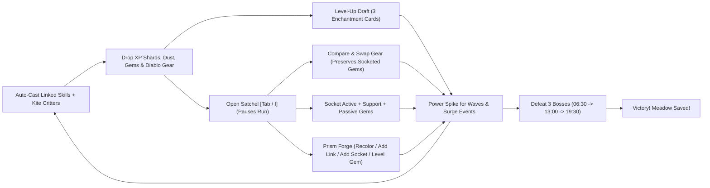

# Paw & Prism — Living Game Design Document (GDD)

> **Status:** Living Design Reference & Rework Blueprint  
> **Baseline Build:** `v1.0` (`main` commit `a962ebd` / WebGL build `gh-pages` `b7c42b7`)  
> **Engine & Renderer:** Godot `4.7.2` (`GL Compatibility`)  
> **Live Web Build:** https://normandra.github.io/paw-and-prism/  
> **Repository:** https://github.com/normandra/paw-and-prism  
> **Target Platforms:** Web (single-threaded HTML5/WASM, no `SharedArrayBuffer`), macOS, Windows, Linux  

---

## How to Use This Document

Each section is split into two layers so you can tune numbers or plan full reworks without losing sight of how the game currently runs:
1. **`Current Implementation` (Code-Verified Baseline):** Exact formulas, tables, timers, and script locations currently running in Godot.
2. **`Rework Ideas & Design Knobs`:** Open design questions, balance levers, and checkable `[ ]` rework tasks ready to edit directly in this file.

---

## 1. High Concept, Core Pillars & Gameplay Loop

**Pitch:** *Vampire Survivors meets Diablo loot & Path of Exile gem linking in a cozy 3D storybook critter meadow.* Choose an adorable woodland hero, kite escalating waves across a 20-minute day-to-twilight gauntlet, scoop up linked skill/support/passive gems and Diablo gear drops on the fly, open your Hero Satchel mid-run to snap together broken gem combos with Prism Dust, and topple 3 telegraphed bosses.

### Core Design Pillars

| Pillar | Inspiration | Current Role in *Paw & Prism* | Primary Code Owners |
|---|---|---|---|
| **1. 3D Chibi Critters** | Cozy storybook diorama | 4 procedural chibi heroes with visible helmet/weapon swapping; 7 regular critter species + 3 unique bosses | `chibi_mesh_factory.gd`, `hero_database.gd`, `arena_builder.gd` |
| **2. Diablo Loot Chase** | *Diablo II / III / IV* | Enemies, elites, Acorn Chests, and bosses drop `Common`/`Magic`/`Rare`/`Unique` items across 6 slots with loot beams and delta comparison | `item_database.gd`, `loot_manager.gd`, `inventory_panel.gd` |
| **3. PoE Gem Linking** | *Path of Exile* | 32 dropped gems (Active, Support, Passive) socket into colored gear links; tag-compatible Supports mutate linked Actives; gems level up with XP | `gem_database.gd`, `item_instance.gd`, `hero_stats.gd`, `poe_socket_widget.gd` |
| **4. 20-Min 3-Boss Gauntlet** | *Vampire Survivors* / *Halls of Torment* | 1200s escalation through Morning → Golden Sunset → Twilight Grove, anchored by scripted boss fights at `06:30`, `13:00`, and `19:30` | `wave_director.gd`, `enemy_database.gd`, `enemy_entity.gd` |

### Core Moment-to-Moment Loop



### Rework Ideas — Core Loop
- [ ] **Mid-run Risk vs. Pause Flow:** Decide whether `[Tab / I]` should stay an unrestricted pause-anytime tactical board or offer an optional *"Smooth Flow / Ironpaw Mode"* with quick-swap hotbars or shrine-gated crafting.
- [ ] **Post-Boss Victory Option:** Add an **"Endless Twilight Mode"** button on the Victory screen after Boss 3 instead of ending immediately, letting players stress-test 6-link builds past `20:00`.
- [ ] **Run Modifiers / Pact Shrine:** Allow optional difficulty curses (e.g., `+30% Enemy Speed`, `+1 Extra Boss Affix` for `+40% Magic Find`) at run start.

---

## 2. Controls, Camera & Core Combat Math

### Controls (`Current Implementation`)

| Input | Action | Notes |
|---|---|---|
| `WASD` / `Arrow Keys` | 8-directional movement | Clamped to `±66.5m` inside `136×136m` arena (`ARENA_HALF_SIZE = 68.0`) |
| `Space` / `Shift` | Hop-Dash (`dash` action) | `0.22s` dash burst at `2.55×` move speed, `0.26s` i-frames, `2.2s` base CD (`min 0.65s`) |
| **Touch Drag** *(Mobile)* | Analog floating virtual joystick (`touch_controls.gd`) | Spawned anywhere outside HUD buttons; `10%` deadzone, `55%` full speed, smooth follow-tether; auto-enables on touchscreen (`?mobile=1` simulates with mouse) |
| **Touch `DASH` Pad** *(Mobile)* | Circular Hop-Dash pad (`bottom-right`) | `54px` radius espresso/gold button with live radial cooldown arc (`DASH_RADIUS * 1.28` hit test) |
| `Tab` / `I` | Toggle Hero Satchel & Prism Socket Board | Pauses simulation; swaps gear and sockets without dropping run state |
| `Esc` | Pause / Resume (`EndScreen` pause overlay) | Also closes Satchel if open |
| `M` | Toggle procedural audio mute | Reflected in HUD button `[M]` |
| `F3` | Toggle FPS pill in top-right HUD | Visible by default when `?review=1` URL param or `--review` CLI arg is set |
| `F7` / `F8` / `F9` (`?review=1` only) | Debug test hooks | `F7`: trigger Level-Up modal · `F8`: seed Unique/Rare/Magic loot + gems · `F9`: trigger Victory |

### Camera Rig (`main_game.gd`)
- **Perspective FOV:** `48.0°`, `far = 160.0`
- **Title Showcase Camera:** Landscape `Vector3(0.0, 2.38, 5.85)` aiming at `(0, 0.56, 0)`; Portrait (`vp.y > vp.x * 1.05`) pulls back to `Vector3(0.0, 2.65, 7.20)` aiming at `(0, 0.25, 0)` to clear the 2×2 hero picker.
- **Gameplay Chase Camera:** Landscape offset `Vector3(0.0, 17.5, 13.5)`; Portrait widens to `Vector3(0.0, 22.5, 17.0)`; exponential lerp `min(1.0, delta * 9.0)` + quadratic trauma screen shake (`_shake_trauma² * 0.55`).

### Exact Combat & Progression Formulas (`player_controller.gd`, `hero_stats.gd`, `gem_instance.gd`)

1. **Incoming Player Damage Mitigation:**
   ```text
   armor_mit = 100.0 / (100.0 + max(0.0, armor) * 1.6)
   dr_mit    = 1.0 - clamp(dmg_reduction, 0.0, 65.0) * 0.01
   final_dmg = max(1.0, raw_dmg * armor_mit * dr_mit)
   ```
   - Standard post-hit invulnerability window: `0.45s` (`1.6s` on Nine-Lives cheat-death save).
   - Dash i-frame floor: `0.26s` (`dash_cd = max(0.65, 2.2 * dash_cd_mult)`, `0.65×` with *Paws of the Comet*).
2. **Compiled Active Skill Damage:**
   ```text
   base_dmg  = def.base_damage + def.damage_per_lvl * (effective_level - 1)
   final_dmg = (base_dmg + flat_damage * 0.85) * damage_mult * product(support_dmg_mult)
   ```
   - `effective_level = gem.level + global_gem_level_bonus (+1 from Prismwhisker Crown) + local_bonus (+1 from Prismatic Mastery in same item)`.
3. **Cooldown & Trigger Rate:**
   ```text
   total_cast_mult = max(0.25, cast_speed_mult) * (1.0 + sum(support_cast_speed_pct) * 0.01)
   final_cooldown  = max(0.14, base_cd / total_cast_mult)
   ```
   - Floor of `0.14s` (~`7.1` casts/sec) protects frame rate against hyper-scaled Speed builds.
4. **Criticals & Elemental Rider Effects:**
   - `crit_chance` clamped `[0%, 95%]`; base `crit_mult = 165%` (multiplicative `+sup_crit_chance` and `+sup_crit_mult`).
   - Added Fire / Cold supports (`sup_ignite`, `sup_chill`) add bonus elemental multipliers and ignite/chill (`35%` slow) statuses.
5. **Hero & Gem XP Scaling:**
   - **Hero XP Curve:** `65.0 * pow(1.24, hero_level - 1)` · Each hero level grants `+5.0` base Max HP plus a 3-card Enchantment Draft.
   - **Gem XP Share:** Every equipped Active, Support, and Passive gem receives `65%` (`0.65×`) of hero XP gained (adjusted by `xp_gain_mult`).
   - **Gem XP Curve (Cap `Lv.10`):** `85.0 * pow(1.42, gem_level - 1)`.

### Rework Ideas & Design Knobs — Combat & Camera
- [ ] **Optional Twin-Stick / Cursor Aiming:** Auto-aim nearest foe works great casually, but adding an optional cursor-aim override (right-click or toggle `[Q]`) makes directional skills (*Boomerang Bone*, *Fireball Berry*, *Acorn Barrage*) much more expressive against elites & bosses.
- [ ] **Dodge-Reward Loop:** Trigger a burst, speed buff, or instant cooldown reset (`Perfect Hop!`) when dashing right through an enemy projectile or boss telegraph.
- [ ] **Status Ailment Depth:** Currently Fire burns and Cold chills (`35%` slow). Consider adding **Lightning Shock** (`+15–25%` damage taken debuff) and **Physical Bleed / Armor Break** so elemental/physical tags matter more in support linking.
- [ ] **Hit-Stop & Micro Feedback:** Subtle 2–3 frame scale squash/stretch on crit hits and boss phase transitions for tactile punch without stalling simulation timers.

---

## 3. Playable Heroes (`scripts/data/hero_database.gd`)

All 4 heroes start with a **Magic** 3-link Starter Weapon (containing 1 Active + 1 Support + 1 empty colored socket), **Common** Cozy Meadow Cap (`+14 Max HP`, `[G, B]` unlinked), **Common** Traveler's Paw Tunic (`+20 Max HP`, 2 linked sockets with starter Passive gem), and **Common** Soft Paw Slippers (`+6% Move Speed`, `[G]`).

| ID | Hero & Title | Base HP | Speed | Armor | Crit | Starter Weapon (3-Link) | Starter Active + Support | Starter Armor Links + Passive | Playstyle Identity |
|---|---|---|---|---|---|---|---|---|---|
| `shiba` | **Mochi the Shiba**<br>*Acorn Ranger* | `135` | `8.4` | `6` | `8%` | *Mochi's Acorn Wand* (`+4 Flat`, `+10% Dmg`, `G=G=B`) | *Acorn Barrage* + *Faster Casting* | `R=G` · *Vitality Meadow* (`+Max HP / Regen`) | Fast kiting ranged ranger with forgiving HP regen |
| `bunny` | **Pip the Bunny**<br>*Starlight Mage* | `118` | `8.9` | `4` | `10%` | *Pip's Star Staff* (`B=B=G`) | *Starlight Orbs* + *Increased Area* | `G=B` · *Aura of Swiftness* (`+Move / Cast Spd`) | Swift AoE blender weaving inside packs with orbiting stars |
| `bear` | **Bramble the Bear**<br>*Honey Paladin* | `175` | `7.6` | `14` | `6%` | *Bramble's Honey Hammer* (`R=R=B`) | *Honey Slam* + *Added Fire & Burn* | `R=R` · *Determination Shell* (`+Armor / DR`) | High-EHP melee bruiser slowing packs in sticky fire slams |
| `cat` | **Nori the Cat**<br>*Storm Whisker* | `122` | `8.8` | `5` | `14%` | *Nori's Spark Claws* (`B=B=G`) | *Whisker Lightning* + *Precision Strikes* | `G=R` · *Precision Whiskers* (`+Crit / Pickup`) | High-crit chain caster scaling crits & magnet pickup |

### Rework Ideas — Heroes
- [ ] **Unique Passive Perks / Signature Traits:** Right now heroes differ only by base stats + starting loadout; once items/gems swap mid-run they converge. Give each hero an irreplaceable **Hero Trait** (e.g., *Mochi: every 4th projectile fires free*, *Pip: Hop-Dash leaves a Starlight Echo*, *Bramble: Armor also adds Flat Slam Damage*, *Nori: Crits bounce +1 chain*).
- [ ] **Manual Hero Ultimate (`[R]` or `[Right-Click]`):** Charge a Prism Meter from kills/shards to unleash a 20s-cooldown signature burst matching the hero's identity.
- [ ] **Unlockable Hero Roster Expansion Slot (Design Template):**
  - [ ] **Hero #5 Concept — Oliver the Owl / Maple the Red Panda / Sprout the Frog:** E.g., Minion/Totem specialist starting with *Spirit Bees* + *Homing Guidance* + *Raccoon's Greed*.
  - [ ] **Alternate Starter Skins / Loadouts:** Unlock Weapon B / Costume B per hero after beating Boss 3.

---

## 4. Path of Exile Gem & Socket Buildcraft System

### Mechanics & Rules (`Current Implementation`)
- **4 Socket Colors:** `Red` (Strength/Melee/Fire), `Green` (Dexterity/Projectile/Speed), `Blue` (Intelligence/Spell/Crit), `White` (Prismatic wildcard — accepts any gem color, and `White` Passive gems fit into *any* colored socket).
- **Socket Budget per Slot (`GameEnums.slot_max_sockets`):**
  - Weapon: `4` max · Armor: `4` max · Helmet: `3` max · Boots: `3` max · Amulet: `2` max · Ring: `2` max (**18 total sockets** max across full gear).
- **Link Groups (`ItemInstance.get_link_groups()`):** Only **contiguously connected** sockets share Support Gems (`[0=1=2 | 3]` means socket `3` does *not* support or receive support from `0–2`). Multiple Actives inside one link group can share the same Supports cleanly.
- **Tag Compatibility (`GemDatabase.does_support_apply`):** Supports with `required_tags = []` apply to any linked Active; otherwise the Active must share **at least one** tag in `required_tags`.
- **Swap Protection (`HeroStats.equip_item_from_bag`):** Equipping new gear automatically extracts old gems, places them into matching empty sockets on the new item where possible, and returns the rest to `gem_pouch` (overflow-safe — leveled gems are never deleted).
- **Level Multiplication:** Equipped gems level to `Lv.10` via `65%` shared run XP or instant **Prism Dust** upgrades (`14 + level * 10` dust per level). *Prismatic Mastery* grants `+1` level to all other gems inside its host item; *Prismwhisker Crown* grants `+1` globally across all 6 equipped items.

### Complete Gem Catalog (`32 Total` — `scripts/data/gem_database.gd`)

#### 4A. Active Skill Gems (`10`)

| ID | Gem Name (Short) | Color | Tags | Base Dmg (+/Lv) | Base CD | Proj / Chain / Pierce / Area | Mechanic Summary |
|---|---|---|---|---|---|---|---|
| `acorn_barrage` | **Acorn Barrage** (`ACRN`) | Green | `Projectile`, `Physical` | `22` (`+5.5`) | `0.68s` | `1` proj, spd `22`, `0` pierce | Snappy auto-targeted acorns |
| `starlight_orb` | **Starlight Orbs** (`STAR`) | Blue | `Spell`, `Orbit`, `AoE` | `19` (`+5.0`) | `0.45s` | `2` orbs, rad `3.4`, `99` pierce | Persistent orbiting stars around hero |
| `honey_slam` | **Honey Slam** (`SLAM`) | Red | `Melee`, `AoE`, `Physical` | `34` (`+8.5`) | `1.35s` | rad `4.2`, `99` pierce | Golden melee shockwave slowing hit foes |
| `whisker_lightning` | **Whisker Lightning** (`ZAP`) | Blue | `Spell`, `Chain`, `Lightning` | `26` (`+6.5`) | `0.92s` | `1` bolt, `2` base chains, spd `30` | Crisp static arcs jumping between foes |
| `petal_cyclone` | **Petal Cyclone** (`PETL`) | Green | `AoE`, `Projectile`, `Physical` | `15` (`+4.2`) | `1.15s` | `6` petals, `1` pierce, spd `14.5` | Spiraling outward ring of sakura petals |
| `fireball_berry` | **Fireball Berry** (`FIRE`) | Red | `Projectile`, `Spell`, `AoE`, `Fire` | `30` (`+7.5`) | `1.25s` | `1` berry, AoE `3.0`, spd `17.5` | Lobs ember-berry with AoE splash + burn |
| `frost_nova` | **Frost Nova** (`FRST`) | Blue | `Spell`, `Projectile`, `AoE`, `Cold` | `20` (`+5.5`) | `1.55s` | `8` shards + rad `4.0` nova, `1` pierce | Radial frost ring + chill shards |
| `boomerang_bone` | **Boomerang Bone** (`BONE`) | Red | `Projectile`, `Physical` | `25` (`+6.5`) | `1.15s` | `1` bone, `99` pierce, rad `0.75` | Piercing treat bone curving back to hero |
| `meteor_pine` | **Meteor Pinecone** (`PINE`) | Red | `Spell`, `AoE`, `Fire` | `52` (`+13.0`) | `2.25s` | AoE `4.1`, `99` pierce | Drops heavy pinecone bomb on densest pack |
| `spirit_bees` | **Spirit Bees** (`BEES`) | Green | `Minion`, `Projectile`, `Physical` | `17` (`+4.5`) | `1.05s` | `2` bees (auto-homing), spd `16` | Homing critter-bees stinging nearby foes |

#### 4B. Support Gems (`12`)

| ID | Support Name (Short) | Color | Required Tags | Level-1 Modifiers & Per-Level Scaling |
|---|---|---|---|---|
| `sup_gmp` | **Greater Multi-Proj** (`GMP`) | Green | `Projectile` | `+2` Projectiles (`+1` at Lv4/7/10), `0.86×` damage multiplier |
| `sup_chain` | **Chain Support** (`CHN`) | Green | `Projectile` or `Chain` | `+2` Chains (`+1` every 2 levels) |
| `sup_fork` | **Fork Support** (`FRK`) | Green | `Projectile` | Projectiles split into `2` angled projectiles on first hit, `1.10×` dmg |
| `sup_aoe` | **Increased Area** (`AOE`) | Blue | `AoE` or `Orbit` | `+35%` Area (`+6%/lvl`), `1.10×` dmg |
| `sup_faster_cast` | **Faster Casting** (`FST`) | Green | *Any Active* | `+28%` Cast Speed (`+5%/lvl`) |
| `sup_pierce` | **Pierce Support** (`PRC`) | Green | `Projectile` | `+3` Pierce (`+1/lvl`), `1.12×` dmg |
| `sup_ignite` | **Added Fire & Burn** (`IGN`) | Red | *Any Active* | `+30%` Added Fire (`+5%/lvl`) + Burn DoT |
| `sup_chill` | **Frostbite Support** (`CHL`) | Blue | *Any Active* | `+22%` Added Cold (`+4%/lvl`) + `35%` slow chill |
| `sup_crit` | **Precision Strikes** (`CRT`) | Blue | *Any Active* | `+14%` Crit Chance (`+2%/lvl`), `+45%` Crit Damage |
| `sup_leech` | **Life Leech** (`LCH`) | Red | *Any Active* | Heals hero for `3.0%` (`+0.4%/lvl`) of linked skill's damage dealt |
| `sup_echo` | **Spell Echo** (`ECH`) | Blue | *Any Active* | Triggers twice (`0.78×` dmg/trigger at Lv1, `+0.03×/lvl` = `1.56×` net Lv1!) |
| `sup_homing` | **Homing Guidance** (`HOM`) | Green | `Projectile` | Projectiles home smoothly + `+20%` Projectile Speed |

#### 4C. Passive Skill Gems (`10`)

| ID | Passive Name (Short) | Color | Bonus @ Lv.1 | Per-Level Scaling | Special Effect |
|---|---|---|---|---|---|
| `pas_swiftness` | **Aura of Swiftness** (`SWFT`) | Green | `+16%` Move Spd, `+12%` Cast Spd | `+2%` Move, `+2%` Cast | — |
| `pas_vitality` | **Vitality Meadow** (`VIT`) | Red | `+45` Max HP, `+3.5` HP Regen/s | `+12` HP, `+0.7` Regen/s | — |
| `pas_determination` | **Determination Shell** (`DET`) | Red | `+28` Armor, `+10%` Dmg Red | `+7` Armor, `+1.5%` DR | — |
| `pas_wrath` | **Wrath of Storms** (`WRTH`) | Blue | `+8` Flat Dmg, `+18%` Dmg | `+2.5` Flat, `+4%` Dmg | — |
| `pas_precision` | **Precision Whiskers** (`PRCS`) | Green | `+14%` Crit Chance, `+30%` Pickup | `+2.5%` Crit, `+6%` Pickup | — |
| `pas_clarity` | **Clarity Prism** (`CLRY`) | Blue | `+18%` Cast Spd, `+22%` Area | `+3%` Cast, `+4%` Area | — |
| `pas_greed` | **Raccoon's Greed** (`GRD`) | White | `+35%` Magic Find, `+18%` XP Gain | `+8%` MF, `+4%` XP | Fits any socket |
| `pas_thorns` | **Bramble Thorns** (`THRN`) | Red | `+20` Armor, `+15%` Dmg | `+5` Armor, `+3.5%` Dmg | Triggers `4.2m` Bramble Nova (`22 + 0.8*Armor` dmg) on hit (`1.2s` CD) |
| `pas_vampiric` | **Vampiric Fang** (`VAMP`) | Red | `+2.5` Life on Hit, `+25` Max HP | `+0.7` LoH, `+8` HP | — |
| `pas_prism_mastery` | **Prismatic Mastery** (`PRSM`) | White | `+22%` Dmg | `+5%` Dmg | `+1 Level` to all other gems socketed in the same item! |

### Rework Ideas & Design Knobs — Gem & Socket System
- [ ] **Tradeoffs on Passive Gems (Reservation / Saturation):** Right now Passives have zero opportunity cost other than occupying a socket. Testing a *"Max Active Auras"* or link-synergy rule (e.g., *Passives gain +25% effect per linked Red/Blue/Green socket*) makes Passive placement inside links meaningfully strategic!
- [ ] **Distinct Support Constraints & Visual Clarity:**
  - [ ] Fix *Starlight Orbs* + *Greater Multi-Proj* vs *Chain* expectations clearly on gem tooltips (`uses_proj` currently enables `extra_projectiles` on both `Projectile` and `Orbit` skills; document or separate `Orbit` count supports cleanly).
  - [ ] Add live **Skill DPS / Cooldown Preview** next to each linked group inside `InventoryPanel` so players immediately see `GMP` + `Echo` math update when socketing.
- [ ] **Gem Fusion / Awakening:** Let players combine two `Lv.3+` duplicate gems or spend Boss Dust to unlock **Transfigured Variants** (e.g., *Acorn Barrage of Ricochet*, *Cold-Converted Honey Slam*).
- [ ] **Ergonomic Improvements:** Add right-click quick-socket / quick-unsocket, plus drag-and-drop gem reordering between sockets in the same item.

---

## 5. Diablo-Style Equipment, Loot Economy & Prism Forge

### Gear Slots & Base Item Families (`scripts/data/item_database.gd`)

| Slot | Base Item Pool | Implicit Stat Families | Max Sockets |
|---|---|---|---|
| **Weapon** | Acorn Wand, Honey Hammer, Starlight Staff, Paw Claws | Flat Damage, % Damage, Cast Speed, Crit Chance | `4` |
| **Helmet** | Sprout Hood, Wizard Hat, Knight Cap, Ribbon Hood | Max HP, Area Size, Armor, XP Gain | `3` |
| **Armor** | Cozy Tunic, Bark Breastplate, Velvet Cloak | Max HP, Armor, Damage Reduction | `4` |
| **Boots** | Soft Paw Slippers, Meadow Greaves, Cloud Treads | Move Speed, Pickup Radius | `3` |
| **Amulet** | Acorn Pendant, Silver Bell Charm, Prism Locket | HP Regen, Crit Damage, Magic Find | `2` |
| **Ring** | Clover Ring, Amber Band, Dewdrop Signet | Cast Speed, % Damage, Life on Hit | `2` |

### Rarity & Roll Rules (`Current Implementation`)
- **Item Level (`iLv.1–25`):** `clamp(1 + floor(elapsed_sec / 60), 1, 20)` from waves (`+2` from bosses). Implicit base value scales by `1 + 0.14 * (ilvl - 1)`.
- **Affix Counts:** `Common` = `0` bonus affixes · `Magic` = `1–2` · `Rare` = `3–4` · `Unique` = fixed template scaling by `1 + 0.035 * (ilvl - 1)`.
- **Drop Rarity Odds:** Base `Unique 4%`, `Rare 22%`, `Magic 44%`, `Common 30%`. Magic Find multiplies Unique up to `22%` and Rare up to `45%`.
- **Socket & Link Roll Rates:** `Magic` guarantees `min(2, max_s)` sockets; `Rare` guarantees `min(3, max_s)`. Link probability per gap scales as `0.42 + rarity * 0.14 + ilvl * 0.015` (clamped `35%–88%`), `5%` base chance per socket to roll **White**.

### Complete Unique Item Catalog (`8 Uniques`)

| Unique Name | Slot | Sockets & Links | Special Mechanic + Highlight Stats |
|---|---|---|---|
| **Grand Acorn Scepter** | Weapon | `G=G=B=R` (4L) | `+2 Extra Projectiles` globally + `+18 Flat`, `+36% Dmg`, `+18% Cast Spd` |
| **Prismwhisker Crown** | Helmet | `W=W=W` (3L) | `+1 Level to ALL socketed gems globally`, `+65 HP`, `+24% Area`, `+35% MF` |
| **Honeycomb Aegis** | Armor | `R=R=B=G` (4L) | Triggers a sticky `4.8m` Honey Nova (`28 × DmgMult`) when hit (`1.8s` CD), `+120 HP`, `+45 Armor`, `+14% DR` |
| **Paws of the Comet** | Boots | `G=G=B` (3L) | `-35% Hop-Dash cooldown` (`0.65×`), `+32% Move Spd`, `+16% Cast Spd`, `+40% Pickup` |
| **Nine-Lives Bell** | Amulet | `W=B` (2L) | Cheat death (`90s` CD): prevents lethal blow, heals `55%` Max HP, `+20% Crit`, `+55% Crit Dmg` |
| **Starweaver Band** | Ring | `B=G` (2L) | Massive AoE caster ring: `+35% Area`, `+25% Cast Spd`, `+24% Dmg` |
| **Brambleclaw Gauntlets** | Weapon | `R=R=G=W` (4L) | Brawling/sustain claws: `+24 Flat Dmg`, `+5.5 Life on Hit`, `+15% Crit`, `+28% Dmg` |
| **Twilight Clover Loop** | Ring | `W=G` (2L) | Farming/scaling ring: `+60% Magic Find`, `+30% XP Gain`, `+50% Pickup Radius` |

### Drop Sources & Prism Dust Economy (`loot_manager.gd`, `hero_stats.gd`, `item_instance.gd`)

| Source | Drops & Guarantees | Inventory / Floor Limits |
|---|---|---|
| **Regular Critter** | Always `1` XP shard (`1.25×` on Web to offset `0.72×` active enemy cap); `3.2%` gear (scales w/ MF); `2.4%` gem; `3.5%` heart (`26 HP`); `4%` `4 Dust` | Floor XP shards merge into farthest shard at `140` shards |
| **Elite Critter** *(purple ring, every ~52s)* | `1` Magic/Rare gear (`38%+` Rare), `72%` chance gem, `8 Dust`, `45%` heart (`32 HP`) | Unlooted ground labels projected onto HUD |
| **Acorn Treasure Chest** *(every 50s)* | `1` Magic/Rare item (`55%` Rare), `1` random gem, `12 Dust`, `35 HP` heal | Spawned `16–26m` from hero with announcement banner |
| **Boss (3 per Run)** | **Loot Fountain:** `1` Unique + `2` Rare items (`ilvl+2`), `3` gems (`1 Active + 1 Support + 1 Passive` @ Lv `min(4, 1+boss_idx)`), `25 + 15*boss_idx` Dust, `65 HP` heal | Bag cap: `24` items · Gem pouch cap: `24` gems |

| Prism Dust Action | Amount / Cost | Formula / Rule |
|---|---|---|
| Salvage Item | `+Dust` | `Common 4 / Magic 8 / Rare 16 / Unique 35` + `2 × sockets` + `item_level` (auto-rescues gems first) |
| Salvage Gem | `+Dust` | `6 + (level - 1) * 5` |
| Bulk Salvage | `+Dust` | One-click salvages all `Common` & `Magic` items in `item_bag` |
| **Recolor Sockets** | `-10 Dust` | Rerolls all socket colors (`8% White, 31% R/G/B`) keeping links & extracting nothing |
| **Add Link** | `-15 Dust` | Connects one random unlinked socket gap on selected equipped item |
| **Add Socket** | `-25 Dust` | Adds 1 socket up to slot max (`45%` chance auto-linked to neighbor) |
| **Level Up Gem** | `-(14 + 10*lvl)` Dust | Instantly adds `xp_to_next` XP to selected pouch gem (up to `Lv.10`) |

### Rework Ideas & Design Knobs — Gear & Crafting
- [ ] **Affix Reroll / Chaos Craft:** Add a `Reroll Affixes (20 Dust)` or `Upgrade Rarity` craft in Prism Forge so high-link low-rarity bases can become chase endgame crafts (*PoE crafting bench feel*).
- [ ] **Auto-Salvage Filter Toggle:** Add a toggle pill (`Ignore Common` / `Auto-Dust Common`) right inside Looted Gear or HUD so late-game runs stay snappy without filling the 24-slot bag every 20 seconds.
- [ ] **Unique Build Diversity (Target `16+` Uniques):** Expand Uniques for Boots/Amulets/Helmets that warp mechanics (e.g., *Echoing Bell: Skills cast twice on Hop-Dash*, *Mushroom Crown: Enemies explode in toxic spore clouds*).
- [ ] **Ground Hover Previews:** Display compact rarity + slot + socket preview tags cleanly without clutter when multiple drops stack near boss deaths.

---

## 6. Level-Up Enchantment Draft System (`scripts/ui/level_up_modal.gd`)

Each hero level pauses combat and deals **3 randomized Enchantment Cards** (full card clickable or `[1]`/`[2]`/`[3]` hotkeys) with live `Before -> After` stat previews:

| Category Ribbon | Card Title | Effect | Preview Calculation |
|---|---|---|---|
| `OFFENSE` | **Ferocious Paws** | `+14% All Damage` | `Damage: X% -> (X+14)%` |
| `TEMPO` | **Swift Whiskers** | `+12% Attack & Cast Speed` | `Cast Speed: X% -> (X+12)%` |
| `VITALITY` | **Fluffy Heartiness** | `+32 Max HP` & heals `32 HP` | `Max HP: X -> X+32` |
| `ARCANE` | **Blooming Aura** | `+16% Area Size` | `Area Size: X% -> (X+16)%` |
| `PRECISION` | **Sharp Claws** | `+7% Crit Chance` | `Crit Chance: X% -> min(95, X+7)%` |
| `AGILITY` | **Zoomies Boost** | `+10% Move Speed` | `Move Speed: X -> X*1.10` |
| `DEFENSE` | **Acorn Plating** | `+12 Armor` | `Armor: X -> X+12` |
| `TREASURE` | **Lucky Tail** | `+20% Magic Find` | `Magic Find: +X% -> +(X+20)%` |
| `PRISM SURGE` | **Prismatic Surge** | `+140 XP` to all socketed gems | `Equipped Gems: +140 XP` |
| `CRAFTING` | **Prism Dust Pouch** | `+25 Prism Dust` | `Prism Dust: X -> X+25` |
| `SKILL GEM` | **Mystery Skill Gem** | Adds `1` random gem (only if pouch `< 24`) | `Gem Pouch: X -> X+1` |

### Rework Ideas — Level-Up Draft
- [ ] **Card Rarities (Common / Rare / Mythic):** Let luck / Magic Find or every 5th level (`Lv.5, 10, 15, 20`) roll upgraded **Golden Capstone** drafts (e.g., `+1 Extra Projectile`, `+10% Damage Reduction`, `+1 White Socket to Weapon`).
- [ ] **Reroll / Banish Meta Charges:** Give 2–3 Rerolls per run (plus Boss bonus charges) to sharpen targeted buildcraft.
- [ ] **Smart Tag Weighting:** Gently weight drafts toward tags currently equipped in Active Gems (e.g., slightly higher chance of `Blooming Aura` when running `AoE` skills).

---

## 7. 20-Minute Run Pacing, Waves, Enemies & 3 Bosses

### Wave Pacing & Biome Progression (`enemy_database.gd`, `wave_director.gd`)

- **Total Gauntlet Duration:** `1200.0s` (`20:00`), ending on Victory upon defeating Boss 3 (even slightly before `20:00` if spawned at `19:30` and melted fast!).
- **Periodic Events:** Elites spawn every `52s` (first at `45s`), Acorn Treasure Chests every `50s` (first at `32s`), Critter Swarm Surges (`12` Web / `14` Desktop enemies) at **`04:00`**, **`09:30`**, **`15:30`**, and **`18:00`**.
- **Web Performance Scaling:** Web builds cap active regular enemy density to `0.72×` Desktop and award `1.25×` XP per shard for identical leveling pace.

| Time Window | Biome Phase | Enemy Pool | Spawn Int | Batch | HP Scale | Dmg Scale | Max Active (Desk / Web) |
|---|---|---|---|---|---|---|---|
| `00:00–02:00` | Sunny Meadow | Frog, Hedgehog | `0.95s` | `2` | `1.00–1.24×` | `1.00×` | `42` / `30` |
| `02:00–04:20` | Sunny Meadow | Frog, Hedgehog, Owl-Bat | `0.78s` | `3` | `1.25–1.67×` | `1.12×` | `62` / `44` |
| `04:20–07:00` | Sunny Meadow | Hedgehog, Owl-Bat, Boar, Frog | `0.65s` | `3` | `1.70–2.34×` | `1.28×` | `80` / `57` |
| `07:00–10:40` | Golden Sunset | Owl-Bat, Boar, Gloom Fox, Hedgehog | `0.56s` | `4` | `2.40–3.72×` | `1.55×` | `96` / `69` |
| `10:40–14:00` | Golden Sunset | Boar, Gloom Fox, Bandit, Shroom-Toad | `0.50s` | `4` | `3.80–5.40×` | `1.85×` | `112` / `80` |
| `14:00–17:30` | Twilight Grove | Fox, Bandit, Toad, Boar, Owl-Bat | `0.44s` | `5` | `5.50–7.81×` | `2.20×` | `124` / `89` |
| `17:30–20:00` | Twilight Finale | Bandit, Toad, Gloom Fox, Boar | `0.40s` | `5` | `7.80–10.05×` | `2.65×` | `135` / `97` |

### Enemy Roster (`7 Regular Critters` — Single Merged Mesh, Shadows Off)

| ID | Display Name | Base HP | Speed | Contact Dmg | Radius | Base XP | Combat Behavior |
|---|---|---|---|---|---|---|---|
| `slime_frog` | **Dewdrop Frog** | `26` | `3.4` | `7` | `0.65` | `10` | Gentle swarming hopper |
| `hedgehog` | **Spiky Hedgehog** | `36` | `4.6` | `9` | `0.65` | `14` | Fast early rusher |
| `bat_owl` | **Flap Owl-Bat** | `32` | `5.2` | `10` | `0.68` | `15` | Rapid flanking flyer |
| `acorn_boar` | **Tusk Piglet** | `78` | `3.3` | `15` | `0.85` | `24` | Heavy early-mid bruiser |
| `gloom_fox` | **Gloom Fox** | `54` | `4.0` | `13` | `0.72` | `26` | Ranged caster (`10.5` spd purple orbs) |
| `raccoon_bandit` | **Bandit Raccoon** | `96` | `4.4` | `17` | `0.80` | `38` | Tough high-XP late-game raider |
| `shroom_toad` | **Puff Shroom-Toad** | `68` | `3.1` | `14` | `0.78` | `28` | Spawns `3.2m` delayed spore explosion (`0.65s`) on death |

### 3 Scripted Boss Encounters (`enemy_entity.gd`)

| Spawn Time | Boss Name | Base HP | Speed | Dmg | XP | Attack Cycle | `<= 50%` HP Enrage (`1.32×` Attack Rate) |
|---|---|---|---|---|---|---|---|
| **06:30** (`390s`) | **Sir Grizzle, Honey-Armored King** | `2,400` | `4.0` | `26` | `320` | Alternates `5.4m` Honey Slam (`1.05s` windup) & telegraphed Dash Charge (`0.85s` windup, `3.4×` spd burst) | *"Summoning Honey Guard!"* — spawns 4x `acorn_boar` |
| **13:00** (`780s`) | **Lady Whiskers, Arcane Owl-Empress** | `6,200` | `4.3` | `34` | `540` | 3-step cycle: `7`-way (`9` enraged) fan volley, `5x` delayed meteor rings (`2.6m`), `12`-orb radial ring | *"Arcane Tempest Unleashed!"* — upgrades fan volleys & faster casting |
| **19:30** (`1170s`) | **King Bramblehorn, Prism Stag-Dragon** | `13,500` | `4.6` | `44` | `1,000` | 3-step cycle: `12`-way (`16` enraged) spinning spiral volley, `4x` staggered meteor slams (`2.9m`), cross nova (`6.2m` center + 4 cardinal `3.0m` zones) | *"Prism Overdrive! Gloom Foxes Join!"* — spawns 3x `gloom_fox` |

### Rework Ideas & Design Knobs — Waves & Bosses
- [ ] **Selectable Maps / Biomes:** Keep *Sunny Meadow* as Stage 1 and design Stage 2 (*Honeycomb Hollow* — tight lanes, sticky honey slow pools) and Stage 3 (*Starlit Observatory* — low-gravity meteors & prism crystals).
- [ ] **Boss Identity & Arena Lockdown:** When a boss spawns, optionally draw a subtle luminous `28m` ritual perimeter or clear weak trash stragglers into an honor duel feeling, and display a dedicated **Boss Health + Phase Bar** below the clock plaque.
- [ ] **Fast / Turbo Mode Preset (`10-Min Blitz`):** Players often want both the full `20:00` classic gauntlet (`06:30 / 13:00 / 19:30`) and a selectable `10:00` turbo pacing preset (`03:15 / 06:30 / 09:45`, `2×` XP & drop rates).

---

## 8. Art Direction, UI Design System & Audio

### Storybook UI System (`ui_helper.gd`, `ui_icons.gd`, `poe_socket_widget.gd`)

1. **3-Tier Warm Timber & Enchanted Gold Palette:**
   - Outer Frame (`BG_WOOD_DEEP`): `#1C1412` (`Color(0.11, 0.08, 0.07, 0.97)`)
   - Column / Panel (`BG_WALNUT`): `#30241C` (`Color(0.19, 0.14, 0.11, 0.98)`)
   - Raised Interactive Card (`BG_OAK_CARD`): `#3D2E24` (`Color(0.24, 0.18, 0.14, 0.98)`)
   - Recessed Well / Socket Slot (`BG_WELL`): `#17120F` (`Color(0.09, 0.07, 0.06, 0.96)`)
   - Trim & Text: Enchanted Gold `#F5C957`, Antiqued Brass `#947342`, Muted Pewter (Common) `#7A6E61`, Cream `#FCF5E6`, Parchment `#E0D1B3`.
   - Tactile CTAs: Emerald (`#309454`), Ruby (`#8F303B`), Sapphire (`#335E94`) with darkened pressed & disabled bevels.
2. **Typography & WebGL OpenType Gotchas:**
   - Bundled SIL OFL variable fonts: `assets/fonts/Fredoka.ttf` (`wght 300–700`) and `assets/fonts/Nunito.ttf` (`wght 200–1000`).
   - **Important Engine Rule:** Godot 4 `FontVariation.variation_opentype` requires the **integer FourCC tag** (`TextServer.name_to_tag("wght")` = `2003265652`), *never* the string `"wght"`. Weights pinned: Fredoka `700`, Nunito body `600`, Nunito bold `800`.
   - **Glyph Safety Rule:** Do **not** use arrows or triangles (`←`, `▲`, `▼`) — `Nunito.ttf` lacks them and WebGL renders tofu `□` boxes. Stick strictly to ASCII (`->`, `(+4.0)`) and verified symbols (`·`, `•`, `—`).
3. **Iconography & PoE Socket Grammar:**
   - Custom runtime SVGs (`UiIcons`) cover 4 hero portraits, 6 gear slots, all 10 active skills, faceted gem silhouettes, and UI/crafting glyphs.
   - **Socket Silhouettes (`PoESocketWidget`):** Active = **Pentagon**, Support = **Round Orb**, Passive = **Hexagon**, with `2px` outlines, forged golden link bars, pulsing gold drop-target halos when a compatible gem is selected, and unclipped dark pill badges (`ACR 1`, `FST 1`) anchored underneath. Always initialize default `custom_minimum_size` inside `_init()`, *never* `_ready()`, so `configure_mini()` isn't overwritten on `add_child()`.

### 3D Visuals & Audio (`chibi_mesh_factory.gd`, `arena_builder.gd`, `sfx_manager.gd`)
- **Materials:** Chibi meshes use `DIFFUSE_LAMBERT` (`roughness 0.78`, `rim 0.10`) paired with `TONE_MAPPER_FILMIC` (`exposure 0.90`) and `fog_density 0.0055` to eliminate harsh white specular blowout.
- **Arena & Landmarks:** `136×136m` meadow (`±68m`), procedural weathered radial cobblestone center plaza texture, `2`-tier pine trees (`cast_shadow = OFF`), `36` midground shrubs (`MultiMesh`), multi-color wildflowers (excluded from plaza `r < 8m`), and mossy boundary pillars topped with warm amber lanterns. Hero has a dark contact shadow (`alpha 0.50`) + golden locator ring (`HeroLocatorRing`).
- **Procedural Audio:** `SfxManager` synthesizes 15 mono WAV streams (`22050 Hz`, 12-voice pool, `35ms` rate-limit debounce): `xp_plink`, `hit_pop`, `crit_sparkle`, `player_hurt`, `dash_whoosh`, `loot_common`, `loot_rare`, `loot_unique`, `gem_drop`, `level_up`, `boss_horn`, `ui_click`, `equip_snap`, `socket_chime`, `victory_fanfare`.

### Responsive Mobile Support (`touch_controls.gd`, `main_game.gd`, `export_presets.cfg`)
- **Adaptive Portrait Scaling:** `MainGame._update_responsive_scale()` increases `root.content_scale_factor` up to `1.72` on tall portrait screens so typography and touch targets remain crisp without overflowing narrow phone viewports.
- **Screen Adaptation (`vp.x < 960` / `< 900`):** `TitleScreen` switches to a 2×2 grid + stacked start button; `HudController` compacts top bar pills, raises the skill bar above bottom touch zones, and enables multi-touch `TouchControls`; `InventoryPanel` stacks Equipped/Sockets over a 3-tab right pane (`Looted Gear`, `Skill Gems`, `Hero Stats`); `LevelUpModal` stacks 3 vertical cards; `EndScreen` clamps horizontally.
- **Mobile Browser Shell (`export_presets.cfg`):** Web export enables `for_mobile=true` texture compression and injects `apple-mobile-web-app-capable`, `mobile-web-app-capable`, `overscroll-behavior: none`, `touch-action: none`, and anti-callout CSS.

### Rework Ideas & Remaining Art Polish
- [ ] **Art Design Reviewer Non-Blocking Micro-Polish:**
  - [x] Toast pills (`hud_controller.gd`): set `SIZE_SHRINK_END` on toast `PanelContainer`s so short notices (`+25 Prism Dust!`) hug text width cleanly.
  - [ ] Ground Locator Ring smoothness (`chibi_mesh_factory.gd`): bump torus radial ring count (`14 -> 24`) for a silky circle up close on Title Screen.
- [ ] **True 3D Assets & Animations:** Swap procedural primitive heroes/bosses for exported stylized `.glb` meshes + skeletal idle/walk/attack clips (`AnimationTree`) while preserving the `WeaponMount` / `HatMount` bone attachments.
- [ ] **Dynamic Music Track:** Layer a gentle acoustic woodland loop (morning) → warm folk rhythm (sunset) → synth-strings boss theme (twilight/bosses) via Godot WebAudio.

---

## 9. Technical Architecture, Codebase Map & Performance Guardrails

### Complete File & Module Map

| Layer | Files (`res://scripts/...`) | Responsibility |
|---|---|---|
| **Orchestration** | `main_game.gd`, `scenes/main.tscn` | GameState machine (`TITLE`, `PLAYING`, `INVENTORY`, `LEVEL_UP`, `PAUSED`, `ENDED`), responsive scaling, touch detection, `?review=1` / `?mobile=1` hooks, Web Retina scale |
| **Static Databases** | `data/game_enums.gd`, `hero_database.gd`, `enemy_database.gd`, `gem_database.gd`, `item_database.gd` | Enums, 4 heroes, 7 critters + 3 bosses + 7 wave stages, 32 gems, 6 gear slots & 8 Uniques |
| **Runtime Models** | `models/hero_stats.gd`, `item_instance.gd`, `gem_instance.gd` | Gear equip/salvage, contiguous socket link compiler, XP math, full stat aggregation |
| **3D Entities** | `entities/player_controller.gd`, `enemy_entity.gd`, `projectile_entity.gd`, `area_effect_entity.gd`, `world_pickup.gd` | Hero keyboard + touch movement/dash/reactive novas, enemy/boss AI & enrages, pierce/chain/fork/homing projectiles, AoE telegraphs, loot drops & beams |
| **Systems** | `systems/skill_executor.gd`, `wave_director.gd`, `loot_manager.gd`, `spatial_grid.gd`, `sfx_manager.gd` | Auto-cast triggers/echoes/orbits, timed waves/surges/chests/bosses, loot fountains, spatial hash & zero-alloc separation, WAV synth |
| **Visuals** | `visuals/chibi_mesh_factory.gd`, `arena_builder.gd` | Cached merged enemy `ArrayMesh`es, dynamic hero hats/weapons, lighting/sky/fog, radial cobblestone plaza, instanced nature props |
| **UI Screens** | `ui/ui_helper.gd`, `ui_icons.gd`, `poe_socket_widget.gd`, `touch_controls.gd`, `title_screen.gd`, `hud_controller.gd`, `inventory_panel.gd`, `level_up_modal.gd`, `end_screen.gd` | Storybook theme/fonts, runtime SVG art, full & mini PoE socket diagrams, multi-touch joystick & Dash pad, Title dock, 10 Hz HUD + 60 Hz popups, Satchel, Draft cards, Pause/Victory summary |
| **QA & Builds** | `tests/verify_game.gd`, `scripts/build_all.sh`, `export_presets.cfg` | Headless end-to-end verification suite & 4-platform export pipeline (`Web`, `macOS`, `Windows`, `Linux`) |

### Non-Negotiable WebGL / M1 Performance Guardrails

When reworking systems or adding new content, preserve these hard-won frame-rate protections (`57 FPS` verified at `1280×800` WebGL):
1. **No Unmerged Multi-Part Regular Enemies:** Always keep regular enemies as a single cached multi-surface `ArrayMesh` (`cast_shadow = OFF`) and unshaded ground shadow disc.
2. **No Per-Frame `ProceduralSkyMaterial` Edits:** Biome sky updates are throttled (`2.5s` + color delta threshold) because changing `ProceduralSkyMaterial` forces WebGL cubemap baking stalls.
3. **Keep `scaling_3d_scale = 0.78` + `MSAA_DISABLED` on Web Retina** (`CanvasLayer` 2D UI stays native crisp!) and **`SHADOW_ORTHOGONAL` (`1024px`, `32m`)** with reflections disabled.
4. **Never Rebuild Heavy UI Widgets Every XP Shard:** Keep `hud_controller.gd` labels/projections throttled (`10 Hz`) and only call `rebuild_skill_bar()` on level-up or gear/gem change.
5. **Single-Cell Staggered Separation:** `SpatialGrid.compute_separation()` checks at most 5 neighbors in the enemy's own cell every 2nd frame — keep crowd physics $O(N)$ without per-frame array allocations.

### Dev, Verification & Deployment Workflow
- **Headless Test Suite (run after any gameplay/data/UI change):**
  ```bash
  "/Applications/Godot 2.app/Contents/MacOS/Godot" --headless --path /Users/normanmahendra/Documents/CardThrone --import
  "/Applications/Godot 2.app/Contents/MacOS/Godot" --headless --path /Users/normanmahendra/Documents/CardThrone --script res://tests/verify_game.gd
  ```
- **Build All 4 Exports (note: `builds/` is gitignored; `builds/web/.import` must stay absent):**
  ```bash
  ./scripts/build_all.sh
  ```
- **Visual Debug Flags:** Append `?review=1` in WebGL (or `--review` on Desktop) to unlock `F3` (FPS toggle), `F7` (Level-Up modal), `F8` (Seed sample Unique/Rare gear & gems), and `F9` (Victory screen). Append `?mobile=1` (or `--mobile`) on desktop to enable `TouchControls` mouse drag emulation for testing mobile play in a browser.

---

## 10. Prioritized Rework Backlog (Editable Roadmap)

### Track A — Combat Feel & Game Juice *(Highest Impact Next)*
- [ ] Add optional **Aim Mode Toggle (`Auto / Cursor`)** so projectiles and *Honey Slam* can be aimed tactically around elites/bosses.
- [ ] Add **Lightning Shock** & **Physical Bleed / Crush** status ailments alongside Fire Burn and Cold Chill.
- [ ] Add **Boss Health Bar** + phase indicator banner directly under the top-center timer plaque during boss fights.
- [ ] Add **Hit-stop / Impact Particles** on crit kills, Honey Slam impact, and boss defeats.

### Track B — Meta-Progression & Replayability
- [ ] Add `SaveSystem` (`user://save.json`, IndexedDB-backed in Godot Web!) tracking unlocked heroes, total runs, best survival times, defeated boss badges, and discovered **Unique Codex / Gemopedia**.
- [ ] Add permanent **Prism Sanctuary Upgrades** bought with earned Victory Shards (`+Starting Dust`, `+1 Reroll Token`, `+Starter Socket Link`).
- [ ] Add **Run Presets:** `20-Min Classic`, `10-Min Blitz`, and `Endless Twilight` toggle after Boss 3.

### Track C — Buildcraft, Crafting & UI QoL
- [ ] Add **Hero-Specific Innate Passives** so hero choice shapes end-game builds beyond minute 5.
- [ ] Add **Live Linked DPS Tooltip** inside `InventoryPanel` showing computed DPS + cooldown + extra proj/chain stats per Active Skill group.
- [ ] Add **Auto-Salvage Filter** (`Auto-Dust Common`) + **Affix Reforge (`20 Dust`)** in Prism Forge.
- [ ] Add **Level-Up Reroll / Banish** tokens + Lv.5/10/15/20 **Golden Capstone** enchantment drafts.

### Track D — World, Enemies & Presentation
- [ ] Build **Stage 2 (*Honeycomb Hollow*)** & **Stage 3 (*Starlit Observatory*)** with distinct arena landmarks and hazards.
- [ ] Add **Random Map Shrines** (Healing Spring, Frenzy Totem, Prism Anvil for free link/recolor, Challenge Bell for bonus elite loot).
- [ ] Add **Adaptive Background Music** + minor UI micro-polish (shrunk toast pill width + smoother hero locator ring).

---

### Working Design Notes & Change Log

> *Use this scratchpad for playtest observations, balance tweaks, or upcoming rework specs.*

- **Playtest Note (`2026-11-24`):**
  - WebGL M1 performance & Storybook UI v2 shipped live (`57 FPS` at `1280×800`, Art Design Reviewer approved).
  - Mobile support shipped (`TouchControls` multi-touch floating joystick + circular `DASH` pad, responsive portrait/landscape UI across all 5 screens, mobile web CSS/compression — verified live at `390×844` @ `51 FPS` and `844×390` @ `66 FPS` with zero desktop regression). Next focus candidates: `[your notes here]`.
