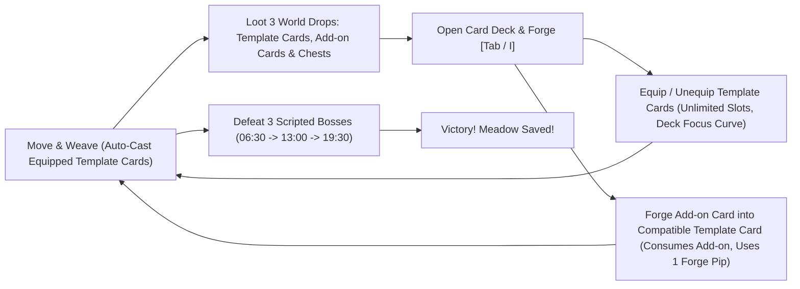

# Paw & Prism — Living Game Design Document (GDD)

> **Status:** Living Design Reference  
> **Version:** `v3.0` (Single-Hero Card-Forging Core — Mochi the Shiba + Template & Add-on Cards)  
> **Engine & Renderer:** Godot `4.7.2` (`GL Compatibility`)  
> **Live Web Build:** https://normandra.github.io/paw-and-prism/  
> **Cards & Forging Catalog:** [docs/ITEMS_AND_SKILLS.md](https://github.com/normandra/paw-and-prism/blob/main/docs/ITEMS_AND_SKILLS.md)  
> **Repository:** https://github.com/normandra/paw-and-prism  
> **Target Platforms:** Web (single-threaded HTML5/WASM + PWA Service Worker, stripped via `build/web_custom.py`), Android (`arm64-v8a` Portrait APK), macOS, Windows, Linux

---

## 1. High Concept, Core Pillars & Gameplay Loop

**Pitch:** *Vampire Survivors meets Slay-the-Spire Card Forging in a sunny-to-twilight 3D meadow.* Play as **Mochi the Shiba** (*Acorn Forgemaster*), weave one-handed through 20 minutes of escalating critter swarms, loot **Template Cards** (auto-casting abilities) and **Add-on Cards** (permanent forge upgrades), forge custom multi-effect cards inside an illustrated Card Deck workshop, and survive 3 telegraphed bosses.

### Core Design Pillars

| Pillar | Design Choice (`v3.0`) | Primary Code Owners |
|---|---|---|
| **1. Streamlined Single Hero** | Focus core balance, feel, and polish on one mascot (`Mochi the Shiba`: `110 HP`, `6.7` spd) | `hero_database.gd`, `chibi_mesh_factory.gd`, `player_controller.gd` |
| **2. Slay-the-Spire Card System** | Only equip **Cards** — each rendered with custom `160x120` vector art, rarity borders, live compiled `DMG · CD`, and rules text | `card_database.gd`, `card_instance.gd`, `card_widget.gd`, `ui_icons.gd` |
| **3. Template + Consumed Add-on Forging** | **Add-on Cards** are permanently forged into **Template Cards** (and consumed); duplicates stack cleanly | `hero_stats.gd`, `inventory_panel.gd` |
| **4. Rarity Forge Caps & Unlimited Focus Curve** | Forge slots scale by Template Rarity (`Common 1`, `Uncommon 2`, `Rare 3`, `Legendary 4`). Equipping unlimited cards incurs Deck Focus scaling so **~3 forged cards** hit the sweet spot | `game_enums.gd`, `balance_config.gd`, `skill_executor.gd` |
| **5. 3-Beat Forging Tutorial & Mobile Play** | Bare-pawed `TUTORIAL` walks hands-on through **Equip Template -> Forge Add-on**; portrait-friendly touch joystick & momentum scrolling (`TouchScrollContainer`) | `tutorial_director.gd`, `touch_controls.gd`, `hud_controller.gd` |

### Core Moment-to-Moment Loop (`v3.0`)

---

## 2. Controls, Camera & Core Combat Rules

| Input | Action | Notes |
|---|---|---|
| `WASD` / `Arrow Keys` | 8-directional movement | Arena clamped to `±66.5m` inside `136x136m` meadow (`ArenaBuilder.ARENA_HALF_SIZE = 68.0`) |
| **Touch Drag** *(Mobile)* | Analog floating virtual joystick | Drag-anywhere one-handed control; auto-enabled on touchscreens/Android or `?mobile=1` |
| **Touch Swipe** *(Deck / EndScreen)* | Momentum vertical scroll | `TouchScrollContainer` with tap threshold guard so scrolling never triggers accidental equips/forges |
| `Tab` / `I` | Toggle Card Deck & Forge | Pauses run; Desktop 2-pane (`Active Deck | Collection`) or Mobile 3-tab (`Active | Tpl | Add-on`) |
| `Esc` | Pause / Resume | Also closes Card Deck if open |
| `M` | Toggle procedural audio mute | Reflected in HUD `[M]` button |
| `F3` / (`F8`,`F9` with `?review=1`) | FPS counter & review helpers | `F8`: seed Rare/Legendary Templates + Add-ons · `F9`: Victory screen |

### Technical Notes (WebGL & Stripped WASM Compatibility)
- `build/web_custom.py` compiles the Web WASM runtime with `deprecated = "no"` and `target=template_release` (`~26.6 MB` raw / `~6.9 MB` gzip).
- All procedural images (`arena_builder.gd`, `ui_icons.gd`) must strictly use `Image.create_empty(...)` — **never** `Image.create(...)`, which is stripped when `deprecated = "no"` and breaks script compilation in Web WASM.

---

## 3. Cards & Forging Economy (`card_database.gd`, `hero_stats.gd`, `balance_config.gd`)

- **Starter State (20-Min Run):** Mochi enters with 1 **Uncommon Acorn Barrage** (`0/2` Forges).
- **Starter State (Tutorial Mode):** Starts bare-pawed (`0` cards), loots & equips `Uncommon Acorn Barrage`, kills 3 critters, loots `Multi-Shot`, forges it (`1/2`), and clears 5 critters.
- **Deck Focus Cooldown Curve (`compute_deck_cd_mult(N)`):**
  - `1 Card -> 1.00×`
  - `2 Cards -> 1.12×`
  - `3 Cards -> 1.25×` *(Sweet Spot)*
  - `N >= 4 Cards -> 1.25 + 0.35 * (N - 3)` (`4: 1.60×`, `5: 1.95×`, `6: 2.30×`)
- **Card Drop Rates (`loot_manager.gd`):**
  - **Template Cards:** Base `1.60%` / `Pow(spawn_intensity, 0.75)` + pity after `75` kills (`+0.14%/kill`), gated by `22.0s` regular drop cooldown; Elites (`72%`, min Uncommon), Chests (`100%`, `60% Rare / 40% Uncommon`), and Bosses (`100%` **Legendary** Template) guarantee high-rarity upgrade milestones.
  - **Add-on Cards:** Base `2.00%` / `Pow(spawn_intensity, 0.75)` + pity after `60` kills (`+0.16%/kill`), gated by `18.0s` regular cooldown; Elites (`85%`), Chests (`100%`), and Bosses (`2` guaranteed Add-ons: `Rare+` and `Uncommon+`) feed continuous forging choices (~3 well-forged endgame cards plus spare collection cards by `20:00`).

Full tables for all **10 Template Cards** and **24 Add-on Cards** live in [docs/ITEMS_AND_SKILLS.md](https://github.com/normandra/paw-and-prism/blob/main/docs/ITEMS_AND_SKILLS.md).

---

## 4. Enemies, Waves & 3-Boss Gauntlet (`enemy_database.gd`, `wave_director.gd`)

- **Wave Phases (Morning -> Sunset -> Twilight):**
  - `00:00–06:30` (*Sunny Meadow*): `hp_scale 1.0->1.65`, `dmg_scale 1.0->1.15`, `speed_scale 1.0->1.08`, batch `3`, interval `0.85s`, max active `48–75`.
  - `06:30` **Boss 1:** *Sir Grizzle* (`2,000 HP`, `25` dmg, `4.8` spd) — Honey Slam AoE + Telegraphed Charge + 50% HP *Acorn Boar* summon.
  - `06:30–13:00` (*Golden Sunset*): `hp_scale 1.65->2.75`, `dmg_scale 1.15->1.42`, `speed_scale 1.08->1.18`, batch `4–5`, interval `0.62–0.50s`, max active `95–115`.
  - `13:00` **Boss 2:** *Lady Whiskers* (`4,500 HP`, `30` dmg, `5.1` spd) — Arcane Fan Volleys + Sky Strike Zones + 12-bolt Ring Nova.
  - `13:00–19:30` (*Twilight Thicket*): `hp_scale 2.75->4.30`, `dmg_scale 1.42->1.72`, `speed_scale 1.18->1.28`, batch `6`, interval `0.42–0.36s`, max active `130–145`.
  - `19:30` **Boss 3:** *King Bramblehorn* (`9,500 HP`, `33` dmg, `5.5` spd) — Twin Spiral Barrage + Tracking Zones + Cross Slam & Inner Nova + 50% HP *Gloom Fox* summon.

---

## 5. Verification & Export Pipeline

- `tests/verify_game.gd`: Validates single hero `shiba`, merged enemy rigs, 10 Template + 24 Add-on definitions, all 34 custom `160x120` SVG card artworks, `CardWidget` rendering, `1/2/3/4` forge caps, duplicate stacking, Add-on consumption, tag compatibility rejection, Deck Focus scaling, full 3-Beat Forging Tutorial, UI `InventoryPanel` equip/forge flows, and 3-Boss Victory.
- `tests/balance_audit.gd`: Enforces T0 card DPS bounds (`[10, 40]`), `3-Card Forged Endgame` vs `6-Card Unforged Spam` & `3-Forged + 3-Raw Bloat`, Boss 1/2/3 TTKs, Hero hits-to-die lethality, capped sustain, and late-wave enemy speed pressure.
- `.github/workflows/web-release.yml` runs both headless suites on every release build before exporting and deploying the stripped Web WASM build to `gh-pages`.
