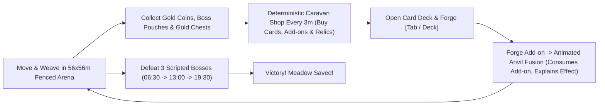

# Paw & Prism — Living Game Design Document (GDD)

> **Status:** Living Design Reference  
> **Version:** `v3.1` (Compact Arena + Deterministic 3-Min Gold Shops + Slay-the-Spire Relics + Card Forging Animations)  
> **Engine & Renderer:** Godot `4.7.2` (`GL Compatibility`)  
> **Live Web Build:** https://normandra.github.io/paw-and-prism/  
> **Cards & Forging Catalog:** [docs/ITEMS_AND_SKILLS.md](https://github.com/normandra/paw-and-prism/blob/main/docs/ITEMS_AND_SKILLS.md)  
> **Repository:** https://github.com/normandra/paw-and-prism  
> **Target Platforms:** Web (single-threaded HTML5/WASM + PWA Service Worker, stripped via `build/web_custom.py`), Android (`arm64-v8a` Portrait APK), macOS, Windows, Linux

---

## 1. High Concept, Core Pillars & Gameplay Loop

**Pitch:** *Vampire Survivors meets Slay-the-Spire Card Forging & Relic Shops in a compact Brotato-style 3D meadow.* Play as **Mochi the Shiba** (*Acorn Forgemaster*), weave one-handed through 20 minutes of escalating critter swarms inside a tight `56×56m` fenced arena with a live HUD Minimap, collect Gold coins/pouches/chests, visit deterministic **Caravan Shops every 3 minutes** to buy **Template Cards**, **Add-on Cards**, and **Slay-the-Spire Relics**, watch juicy anvil-forging animations customize your deck, and survive 3 telegraphed bosses.

### Core Design Pillars

| Pillar | Design Choice (`v3.1`) | Primary Code Owners |
|---|---|---|
| **1. Streamlined Single Hero** | Focused entirely on `Mochi the Shiba` (`110 HP`, `6.7` spd) | `hero_database.gd`, `chibi_mesh_factory.gd`, `player_controller.gd` |
| **2. Slay-the-Spire Cards & Relics** | Equip **Template Cards**, forge consumed **Add-on Cards** (each showing its full rule text on forged cards), and collect 12 passive **Relics** (`160×120` vector art) | `card_database.gd`, `relic_database.gd`, `card_widget.gd`, `ui_icons.gd` |
| **3. Deterministic 3-Min Caravan Shops** | Ground enemies/chests drop **Gold** instead of RNG cards; Caravan Shops open deterministically at `03:00, 06:00, 09:00, 12:00, 15:00, 18:00` with Rerolls, 3 Templates, 4 Add-ons, and 2 Relics | `shop_manager.gd`, `shop_panel.gd`, `loot_manager.gd`, `wave_director.gd` |
| **4. Compact Arena + Live Minimap** | Tight `56×56m` fenced meadow (`ARENA_HALF_SIZE = 28.0`) + real-time HUD **Minimap** tracking Gold, Critters, Elites, Bosses, and Mochi | `arena_builder.gd`, `minimap_widget.gd`, `hud_controller.gd` |
| **5. Anvil Forge Animation & Freedom of Build** | `ForgeAnimationOverlay` animates Add-on fusion with shockwaves & sparks; Rarity sets forge caps (`Common 1..Legendary 4`, `+1` with *Masterwork Anvil*), while players freely choose deck size along the Focus curve | `forge_animation_overlay.gd`, `inventory_panel.gd`, `balance_config.gd` |

### Core Moment-to-Moment Loop (`v3.1`)

---

## 2. Controls, Camera & Core Combat Rules

| Input | Action | Notes |
|---|---|---|
| `WASD` / `Arrow Keys` | 8-directional movement | Clamped inside `56×56m` timber-fenced meadow (`ArenaBuilder.ARENA_HALF_SIZE = 28.0`) |
| **Touch Drag** *(Mobile)* | Analog floating virtual joystick | Drag-anywhere one-handed control; auto-enabled on touchscreens/Android or `?mobile=1` |
| **Touch Swipe** *(Deck / Shop / Summary)* | Momentum scroll | `TouchScrollContainer` with tap threshold guard |
| `Tab` / `I` | Toggle Card Deck & Forge | Pauses run (or jumps from Shop into Deck); tabs are `Active | Templates | Add-ons` |
| `Esc` | Pause / Resume | Closes Deck or Shop cleanly |
| `M` | Toggle procedural audio mute | Reflected in HUD `[M]` button |
| `F3` / (`F7`,`F8`,`F9` with `?review=1`) | FPS counter & review helpers | `F7`: open Caravan Shop · `F8`: +Gold, Relics & Cards · `F9`: Victory screen |

### Technical Notes (WebGL & Stripped WASM Compatibility)
- `build/web_custom.py` compiles the Web WASM runtime with `deprecated = "no"` and `target=template_release`.
- All procedural images (`arena_builder.gd`, `ui_icons.gd`) strictly use `Image.create_empty(...)` — **never** `Image.create(...)`.

---

## 3. Gold Economy, Shops & Cards (`shop_manager.gd`, `relic_database.gd`, `hero_stats.gd`)

- **Starter State (20-Min Run):** Mochi starts with **20 Gold** and 1 **Uncommon Acorn Barrage** (`0/2` Forges).
- **Starter State (Tutorial Mode):** Starts bare-pawed (`0` cards), equips `Acorn Barrage`, clears 3 critters, picks up `40G` Pouch to open the **Tutorial Caravan Shop**, buys `Multi-Shot` (`30G`), watches the Anvil Forge animation, and clears 5 critters.
- **Gold Sources (`balance_config.gd`, `loot_manager.gd`):**
  - Regular critters (`56%` drop chance): `2G` (`+1G` chance from `10:00` onward)
  - Elites: `22G` Pouch + `16 HP` heal
  - Bosses: `65G` (`3` Gold Pouches) + `40 HP` heal
  - Periodic Gold Chests (`95s`): `28G` + `20 HP` heal
- **Deck Focus Cooldown Curve (`compute_deck_cd_mult(N)`):**
  - `1 Card -> 1.00×` | `2 Cards -> 1.12×` | `3 Cards -> 1.25×` | `N >= 4 Cards -> 1.25 + 0.35 * (N - 3)` (`4: 1.60×`, `5: 1.95×`, `6: 2.30×`)

Full tables for all **10 Template Cards**, **24 Add-on Cards**, and **12 Relics** live in [docs/ITEMS_AND_SKILLS.md](https://github.com/normandra/paw-and-prism/blob/main/docs/ITEMS_AND_SKILLS.md).

---

## 4. Enemies, Waves & 3-Boss Gauntlet (`enemy_database.gd`, `wave_director.gd`)

- **Wave Phases (Morning -> Sunset -> Twilight):**
  - `00:00–06:30` (*Sunny Meadow*): `hp_scale 1.0->1.65`, `dmg_scale 1.0->1.15`, `speed_scale 1.0->1.08`, batch `3`, interval `0.85s`, max active `48–75`.
  - `06:30` **Boss 1:** *Sir Grizzle* (`2,000 HP`, `25` dmg, `4.8` spd) — Honey Slam AoE + Telegraphed Charge + 50% HP *Acorn Boar* summon.
  - `06:30–13:00` (*Golden Sunset*): `hp_scale 1.65->2.75`, `dmg_scale 1.15->1.42`, `speed_scale 1.08->1.18`, batch `4–5`, interval `0.62–0.50s`, max active `95–115`.
  - `13:00` **Boss 2:** *Lady Whiskers* (`4,500 HP`, `30` dmg, `5.1` spd) — Arcane Fan Volleys + Sky Strike Zones + 12-bolt Ring Nova.
  - `13:00–19:30` (*Twilight Thicket*): `hp_scale 2.75->4.30`, `dmg_scale 1.42->1.72`, `speed_scale 1.18->1.28`, batch `6`, interval `0.42–0.36s`, max active `130–145`.
  - `19:30` **Boss 3:** *King Bramblehorn* (`9,500 HP`, `33` dmg, `5.5` spd) — Twin Spiral Barrage + Tracking Zones + Cross Slam & Inner Nova + 50% HP *Gloom Fox* summon.

---

## 5. Verification & Export Pipeline

- `tests/verify_game.gd`: Validates single hero `shiba`, merged enemy rigs, 10 Template + 24 Add-on definitions, all 34 custom `160x120` SVG card artworks, `CardWidget` rendering, `1/2/3/4` forge caps, duplicate stacking, Add-on consumption, tag compatibility rejection, Deck Focus scaling, full 3-Beat Forging Tutorial, UI `InventoryPanel` equip/forge flows, and 3-Boss Victory.
- `tests/balance_audit.gd`: Enforces T0 card DPS bounds (`[10, 40]`), `3-Card Forged Endgame` vs `6-Card Unforged Spam` & `3-Forged + 3-Raw Bloat`, Boss 1/2/3 TTKs, Hero hits-to-die lethality, capped sustain, and late-wave enemy speed pressure.
- `.github/workflows/web-release.yml` runs both headless suites on every release build before exporting and deploying the stripped Web WASM build to `gh-pages`.
